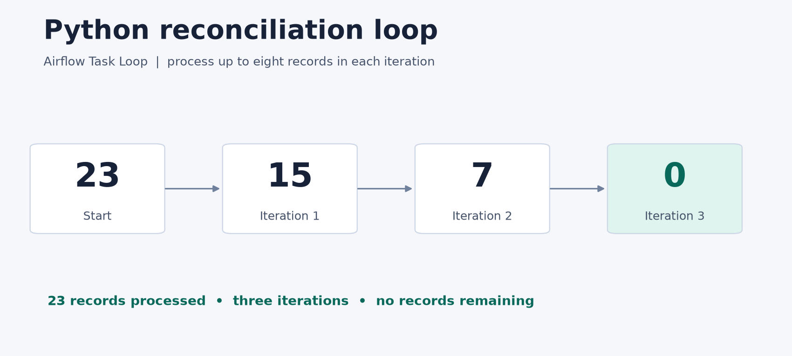
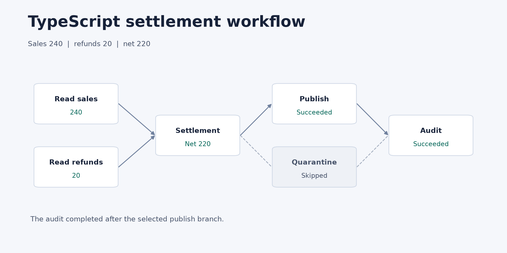
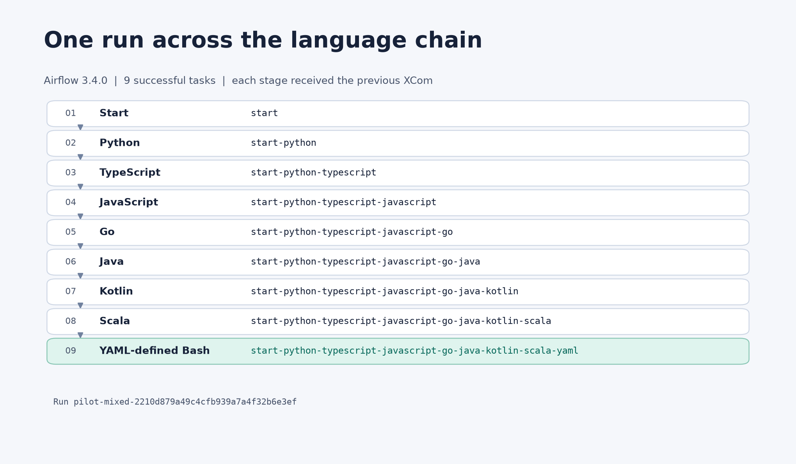

# Deployment and verification

[English](operations-en.md) / [한국어](operations-ko.md) / [Executor behavior](executors-en.md)

See the [plan](../PLAN-en.md) for remaining work and the [results](results-en.md)
for live verification evidence.

## Experiment pass criteria

Use the same input in E01, E02, and E03. Record each run ID and verify the
expected isolation separately using process, Docker event, or Pod evidence.

| Experiment | Input | Pass criteria |
| --- | --- | --- |
| Baseline | `items=10000`, `shards=1` | `partition`, `sum_squares`, and `total` succeed. Final XCom is `333283335000`. |
| Reconciliation loop | Backlog 23, batch size 8 | 14 task instances succeed. Three iterations leave `23 → 15 → 7 → 0` with 23 processed. |
| TypeScript settlement | Sales `[120, 80, 40]`, refunds `[15, 5]` | Six tasks succeed, including publish and audit. `quarantine` skips. Net is `220`. |
| Mixed-language chain | Initial value `start` | Nine sequential tasks succeed and each expected XCom matches. |

A run fails verification if any expected task state or output differs or its
isolation cannot be confirmed.

## Shared baseline

Use one DAG, `pilot_portability`, and one input, `items=10000` and `shards=1`.
The DAG sums the squares of the integers from 0 to 9,999. Its final XCom must
equal `333283335000`. The Typer script submits one run to one Airflow endpoint,
waits for a terminal state, checks the final value, and records the run ID.
See the [verification matrix](../README-en.md#verification-matrix) for all four experiments.

Use the same DAG from [`src/dags/`](../src/dags/) in each environment. The local image embeds the DAG. kind uses the official `apache/airflow:3.4.0` image and mounts the baseline source from a ConfigMap. For the existing external Airflow instance, record its installed version.

Use a Python 3.13 uv environment from `src/` for the script and notebook.
Keep API URLs and bearer tokens in process variables or an ignored repository
`.env`. Give the script access to submit and read DAG runs and read XComs. Use
read access to DAG runs and XComs for the notebook.

## Portable DAG profiles

`scripts/profile.py` builds and verifies a DAG profile for any compatible
Airflow 3.4+ endpoint with the public v2 API. A profile contains the DAG,
its SHA-256, the Airflow configuration to add, and any required runtimes.
`baseline` packages the Python DAG. `mixed` also packages the YAML DAG,
Node.js, Go executable, JRE, and JVM handler JARs from the project's mixed image.
Use a Linux runtime built for the target workers' architecture.

The Airflow API reads registered DAGs and creates runs. To stage a DAG,
use the deployment's Git publishing process or the Kubernetes API to write
the profile to a shared volume. The latter requires a staging Pod with write
access to the volume. Mount the published directory at the profile's
`mount_path` on the Dag processor and workers, and apply the merged settings
through the deployment's configuration process. Keep each DAG ID in one
source. [Airflow public API](https://airflow.apache.org/docs/apache-airflow/3.4.0/stable-rest-api-ref.html)
· [DAG bundles](https://airflow.apache.org/docs/apache-airflow/3.4.0/administration-and-deployment/dag-bundles.html)

```bash
# Run from src/. Use a new output directory for each build.
uv run --locked python scripts/profile.py build baseline /tmp/pilot-baseline
uv run --locked python scripts/profile.py build mixed /tmp/pilot-mixed \
  --container pilot-airflow-mixed
uv run --locked python scripts/profile.py settings /tmp/pilot-mixed \
  --existing /path/to/current-airflow-config.json
uv run --locked python scripts/profile.py stage-kubernetes /tmp/pilot-mixed \
  --context YOUR_CONTEXT --namespace YOUR_NAMESPACE --pod YOUR_STAGING_POD \
  --container YOUR_STAGING_CONTAINER --destination /shared/pilot-mixed
```

Provide a short-lived `AIRFLOW_PROFILE_TOKEN` in the process environment. After
the Dag processor registers the profile, submit with a fixed run ID. Reusing the
ID reads the existing run if it is present. Omit `--submit` for read-only use.

```bash
uv run --locked python scripts/profile.py run /tmp/pilot-mixed \
  --api-url "$AIRFLOW_URL" --run-id pilot-mixed-external-001 --submit
```

## E01. Local Airflow container

Run the shared image as one Docker container with `airflow standalone`.

```bash
docker build -f deploy/Dockerfile -t pilot-airflow-portability:3.4.0 .
bash deploy/local/run.sh
```

The runner binds the API to loopback and enables anonymous admin access for
this local experiment. Open `http://127.0.0.1:8080` in Chrome. On the
`pilot_portability` DAG, select a single run with `items=10000` and `shards=1`.
After the DAG and its three tasks succeed, copy the run ID and use the
read-only Typer command to check the XCom.

```bash
cd src
uv sync --locked --extra notebook
export AIRFLOW_LOCAL_URL=http://127.0.0.1:8080
export PILOT_LOCAL_RUN_ID="YOUR_RUN_ID"
AIRFLOW_LOCAL_TOKEN=$(curl -fsS "$AIRFLOW_LOCAL_URL/auth/token" | uv run --locked python -c   'import json, sys; print(json.load(sys.stdin)["access_token"])')
export AIRFLOW_LOCAL_TOKEN
uv run --locked python scripts/experiment.py inspect --target local --run-id "$PILOT_LOCAL_RUN_ID"
```

For a CLI-triggered run, use `run --target local` in place of the trigger in
Chrome. Use `inspect` to verify a run that already exists.

## E02. Local task containers

For the task-container scenario, build the Airflow image tagged
`pilot-airflow-portability:3.4.0-docker-tasks` with the same Dockerfile, then use
[`deploy/local/run-docker-task.sh`](../deploy/local/run-docker-task.sh).
It serves Airflow on loopback port 8086. The [baseline DAG](../src/dags/portability.py)
uses `DockerOperator(@task.docker)` for `partition`, each mapped `sum_squares`,
and `total` when `PILOT_DOCKER_TASK_IMAGE` is set. The launcher supplies
`python:3.13-slim` by default. Each task passes its result through XCom and
removes its workload container after execution.
[Verification and evidence](https://github.com/jyje/pilot-airflow-portability/issues/2)

Build the `mixed` image to run all four DAGs on E02. Keep the three additional
workflow runs sequential so Docker events can be matched to each run.

```bash
docker build --target mixed -f deploy/Dockerfile -t pilot-airflow-portability:e02 .
PILOT_LOCAL_CONTAINER=pilot-airflow-e02-all PILOT_LOCAL_PORT=8094 \
  PILOT_IMAGE=pilot-airflow-portability:e02 bash deploy/local/run-docker-task.sh
```

Set `AIRFLOW_DOCKER_URL` to `http://127.0.0.1:8094` and provide an
`AIRFLOW_DOCKER_TOKEN` through the environment. Run the commands from `src/`.

```bash
uv run --locked python scripts/experiment.py run --target docker
uv run --locked python scripts/experiment.py workflow loop --target docker
uv run --locked python scripts/experiment.py workflow typescript --target docker
uv run --locked python scripts/experiment.py workflow mixed --target docker
```

The reconciliation loop uses `DockerOperator` for its workload tasks. Airflow's
loop gate runs the predicate in a temporary container and handles the iteration
decision. The TypeScript, Go, and JVM task runtimes use their existing Airflow
coordinator protocol through a loopback relay owned by the process that Airflow
started. The [E02 launcher](../deploy/local/sdk-runtime.py) manages the workload
containers in the E02 service's network namespace.
The YAML chain uses `DockerOperator` for its Bash and Python commands in E02.
Record both the API results and Docker lifecycle events for each run.

## Optional kind reproduction with Helm

Create a dedicated kind cluster. Use the [Kubernetes installer](../deploy/kubernetes/install.sh)
to install chart `1.22.0` with `KubernetesExecutor`. The installer creates the
baseline DAG ConfigMap and mounts `portability.py` as a single file in the DAG
processor and task Pods. Mounting the entire ConfigMap directory causes
Airflow 3.4 to encounter duplicate directory targets through Kubernetes'
projection symlinks. Rerun the installer after changing the DAG source to
roll out a DAG processor with the updated file.
The kind profile allows up to six minutes for API server and scheduler startup.
It disables the triggerer and StatsD because the baseline uses neither deferrable
operators nor StatsD metrics.

```bash
kind create cluster --name airflow-pilot --config deploy/kind/cluster.yaml
bash deploy/kubernetes/install.sh kind-airflow-pilot -f deploy/kind/values.yaml
```

To reproduce the external baseline with the exact DAG file used in its
verified run, extract that revision and pass the file to the kind installer.

```bash
dag_dir=$(mktemp -d)
git show 6e7ccbb:src/dags/portability.py > "$dag_dir/portability.py"
PILOT_DAG_FILE="$dag_dir/portability.py" \
  bash deploy/kubernetes/install.sh kind-airflow-pilot -f deploy/kind/values.yaml
```

Forward the Airflow API to loopback and obtain a token using the chart's
configured Airflow account. Keep `AIRFLOW_KIND_TOKEN` in your shell environment.

```bash
kubectl --context kind-airflow-pilot -n airflow-pilot port-forward \
  --address 127.0.0.1 service/airflow-pilot-api-server 8081:8080
```

Start a Pod watch in another terminal before submitting the run. Worker Pods
can disappear soon after their task completes.

```bash
kubectl --context kind-airflow-pilot -n airflow-pilot get pods --watch
```

```bash
cd src
export AIRFLOW_KIND_URL=http://127.0.0.1:8081
uv run --locked python scripts/experiment.py run --target kind --items 10000 --shards 1
```

Record the three task Pods, the final XCom `333283335000`, and the Airflow run ID.
See [kind verification](https://github.com/jyje/pilot-airflow-portability/issues/3).

## E03. Existing Airflow on external Kubernetes

E03 uses the existing deployment. The public API can submit runs for registered
DAGs. The existing git-sync source provides `pilot_portability`. The
`pilot-e03-dags` ConfigMap provides `reconcile.py`, `settlement.min.mjs` and
`chain.yaml`. The [E03 Helm values overlay](../deploy/kubernetes/e03-values.yaml)
mounts these files in the DAG processor and Kubernetes task Pods and connects
the Node.js, Go and JVM runtimes staged on the existing logs volume. The cluster
repository now manages the Helm values and ConfigMap through Argo CD.
[GitOps deployment](https://github.com/jyje/cluster/pull/423)

Use `pilot-e03-current-baseline-20261126` to verify the baseline on the existing
Airflow 3.4.0 deployment. The DAG file matches the one verified in E01 and E02.
[Baseline source PR](https://github.com/jyje/pilot-airflow-portability/pull/5)

The two Kubernetes profiles use the same official Airflow image,
`KubernetesExecutor`, and the same three Python baseline tasks with
`items=10000` and `shards=1`. kind mounts the current working-tree DAG from a
ConfigMap. The external instance uses Git-Sync and ran the published DAG from
commit `3e31eca`. Kubernetes uses the Python task path in both profiles.
The external task Pod template uses a git-sync init container and requests
`50m` CPU and `256Mi` memory, with a `768Mi` memory limit. The kind template
mounts the DAG file directly and sets no explicit task container resources.

Connect to the existing Airflow service through its authorized API endpoint
or a port forward. Record the installed Airflow version and executor. The
experiment script uses the Airflow 3 public API. Confirm it can read the
baseline DAG `pilot_portability` and its XComs using the access already
granted for the instance. If the DAG is missing, use the instance's
established DAG publishing process.

Set `AIRFLOW_KUBERNETES_URL` and `AIRFLOW_KUBERNETES_TOKEN`, then inspect
the existing run from `src/`.

```bash
uv run --locked python scripts/experiment.py inspect --target kubernetes --run-id pilot-e03-current-baseline-20261126
```

Record the run ID, task states, final XCom, and the isolation unit actually
used by the existing deployment.

All three tasks succeeded in distinct worker Pods, each using the same Git
commit. The run took 54.84 s and returned `333283335000`.
[Verification record](results-en.md#external-kubernetes-verification)

## Compare results in Jupyter

Open the [comparison notebook](../src/notebooks/01-compare-airflow.ipynb) and
supply the three recorded baseline run IDs. Set them in the notebook or export
`PILOT_LOCAL_RUN_ID` (E01), `PILOT_DOCKER_RUN_ID` (E02), and
`PILOT_KUBERNETES_RUN_ID` (E03) before starting Jupyter. Query the existing
runs and their XCom values through each Airflow API. Compare the notebook
records with the CLI output and include the following fields:

| Field | Verification |
| --- | --- |
| Environment and run ID | One known run for each environment |
| DAG and task status | Success in E01, E02, and E03 |
| Final XCom | `333283335000` in E01, E02, and E03 |
| Elapsed time | Report the Airflow start-to-end duration as an observation from a single run |

Record connection failures, timeouts, or missing results against the affected
environment. The required verification scope is E01, E02, and E03.

From `src/`, start Jupyter with `uv run --locked --extra notebook jupyter lab`.
To execute headlessly, use the same environment variables and run:

```sh
uv run --locked --extra notebook jupyter nbconvert --to notebook --execute \
  --output-dir "$(mktemp -d)" notebooks/01-compare-airflow.ipynb
```

For a repeated comparison, run the CLI once per environment in each of five
rounds. Wait for each run to finish before submitting the next. Keep
`items=10000` and `shards=1` for every run. Supply the five IDs for each
environment in round order as comma-separated values in `PILOT_LOCAL_RUN_IDS`,
`PILOT_DOCKER_RUN_IDS`, and `PILOT_KUBERNETES_RUN_IDS`. Jupyter checks the
runs and reports the median, mean, minimum, and maximum durations for each
environment. In the caption, identify the shared local Docker host for E01
and E02 and the separate Kubernetes resources for E03.

See the [five-run comparison](results-en.md#five-run-baseline-comparison) for the recorded results.

## Additional workflow experiments

Use the same Airflow 3.4.0 image and run each workflow once. Start a second
local container on loopback port 8085 to keep the baseline run available.
Wait for Airflow to list both DAGs before running either command.

```bash
docker build -f deploy/Dockerfile -t pilot-airflow-portability:3.4.0-workflows .
PILOT_IMAGE=pilot-airflow-portability:3.4.0-workflows PILOT_LOCAL_PORT=8085   PILOT_LOCAL_CONTAINER=pilot-airflow-workflows bash deploy/local/run.sh

cd src
export AIRFLOW_LOCAL_URL=http://127.0.0.1:8085
AIRFLOW_LOCAL_TOKEN=$(curl -fsS "$AIRFLOW_LOCAL_URL/auth/token" | uv run --locked python -c   'import json, sys; print(json.load(sys.stdin)["access_token"])')
export AIRFLOW_LOCAL_TOKEN
uv run --locked python scripts/experiment.py workflow loop --target local
uv run --locked python scripts/experiment.py workflow typescript --target local
```

| DAG | Flow and pass criteria |
| --- | --- |
| `pilot_reconcile` | Start with 23 pending records. In each native Task Loop iteration, reserve at most eight, apply the batch, and measure the remainder. The gate feeds the result back to the next iteration while records remain. Expect `15 → 7 → 0`, exactly three iterations with a cap of four, and a final XCom reporting 23 processed. |
| `pilot_ts_settlement` | Declare the schedule, tasks, and dependencies in TypeScript. Collect sales and refunds independently, join them into one settlement, branch to publish or quarantine, and run the final audit after the selected path. Expect sales of 240, refunds of 20, net of 220, successful publish and audit tasks, and skipped quarantine. |

Both local runs passed. The Task Loop processed all 23 records over three
iterations (`23 → 15 → 7 → 0`). The TypeScript settlement published and audited
the net total of 220 and skipped quarantine.





The TypeScript Dag Importer uses Node.js 22 in the image and
`@apache-airflow/ts-sdk` 1.0.0. The build type-checks and bundles the DAG with
`airflow-ts-pack`. The Dag Importer is documented as experimental in Airflow 3.4.

For a read-only check of an existing run, add `--run-id RUN_ID` to either
Typer command. In the Airflow UI, select the exact run and open Graph View.
Use the reconciliation group's Iterations tab to inspect each gate decision.
See the [local verification results](results-en.md#additional-local-workflow-verification).

### Mixed-language chain

One run of [`pilot_mixed_language_chain`](../src/dags/mixed/chain.yaml)
passes a string through the language stages in order.
The initial XCom is `start`. Python emits `start-python`, TypeScript emits
`start-python-typescript`, and each later stage appends its own suffix.

| Stage order | Runtime or declaration |
| --- | --- |
| Python | Python process started by BashOperator |
| TypeScript, then JavaScript | Node.js through the TypeScript SDK |
| Go | Executable bundle through the Go SDK |
| Java, then Kotlin, then Scala | JVM through the Java SDK |
| YAML-defined Bash | Shell command from the YAML-defined stage |

The final expected XCom is
`start-python-typescript-javascript-go-java-kotlin-scala-yaml`.
Record the single run ID, all intermediate values, and each task state.
The local verification passed with nine successful tasks and all nine XComs
matching. See the [run evidence](results-en.md#mixed-language-run-evidence).



Build the mixed-language image and start it on a separate loopback port.
Wait for `pilot_mixed_language_chain` to appear in Airflow before running the script.

```bash
docker build --target mixed -f deploy/Dockerfile -t pilot-airflow-portability:3.4.0-mixed .
PILOT_IMAGE=pilot-airflow-portability:3.4.0-mixed PILOT_LOCAL_PORT=8087 \
  PILOT_LOCAL_CONTAINER=pilot-airflow-mixed bash deploy/local/run.sh

cd src
export AIRFLOW_LOCAL_URL=http://127.0.0.1:8087
AIRFLOW_LOCAL_TOKEN=$(curl -fsS "$AIRFLOW_LOCAL_URL/auth/token" | uv run --locked python -c \
  'import json, sys; print(json.load(sys.stdin)["access_token"])')
export AIRFLOW_LOCAL_TOKEN
uv run --locked python scripts/experiment.py workflow mixed --target local
```

The local Python loop and TypeScript settlement have their own completed
verification records in the [results](results-en.md#additional-local-workflow-verification).

### Compare repeated workflow runs in Jupyter

For each of `loop`, `typescript`, and `mixed`, collect five run IDs per
environment with `uv run --locked python scripts/experiment.py workflow CASE --target TARGET`.
Record each attempt with its case, target (`local`, `docker`, or
`kubernetes`), source round, and run ID. Set failed or retried runs aside as
exceptions and submit replacements until each combination has five passes
with all successful task instances on their first attempt.

From `src/`, set `PILOT_WORKFLOW_RUNS` to the absolute path of the
[run manifest](data/workflow-five-runs.jsonl), then open the
[comparison notebook](../src/notebooks/02-compare-workflows.ipynb).
Use the URL and token for each environment. An E01 workflow running on a
separate endpoint accepts the matching `AIRFLOW_LOCAL_<CASE>_URL` and
`AIRFLOW_LOCAL_<CASE>_TOKEN` variables. The notebook checks the task outcomes
and XComs and draws one chart per workflow.

## References

- [Airflow 3.4.0 release and container image](https://airflow.apache.org/blog/airflow-3.4.0/)
- [Airflow standalone quick start](https://airflow.apache.org/docs/apache-airflow/3.4.0/start.html)
- [Airflow Helm chart 1.22.0 and prerequisites](https://airflow.apache.org/docs/helm-chart/1.22.0/)
- [Airflow Task Loops](https://airflow.apache.org/docs/apache-airflow/3.4.0/authoring-and-scheduling/loops.html)
- [Airflow TypeScript SDK](https://airflow.apache.org/docs/apache-airflow/3.4.0/authoring-and-scheduling/language-sdks/typescript.html)
- [Airflow Go SDK](https://airflow.apache.org/docs/apache-airflow/3.4.0/authoring-and-scheduling/language-sdks/go.html)
- [Airflow Java SDK](https://airflow.apache.org/docs/apache-airflow/3.4.0/authoring-and-scheduling/language-sdks/java.html)
- [YAML Dags](https://airflow.apache.org/docs/apache-airflow/stable/authoring-and-scheduling/yaml-dags.html)
