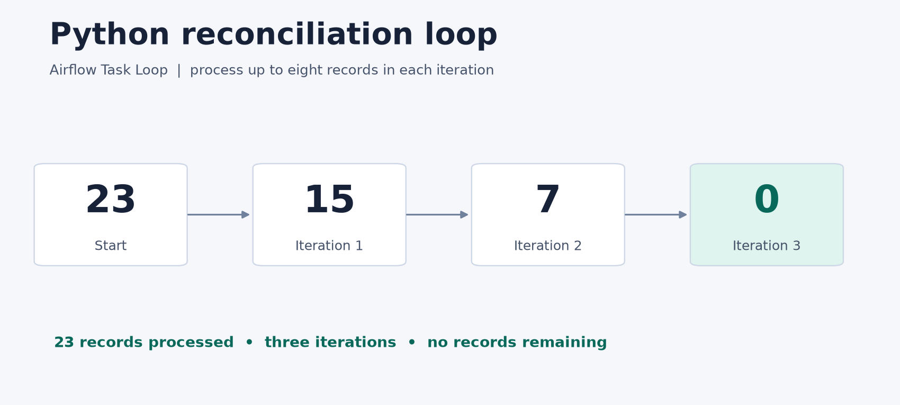
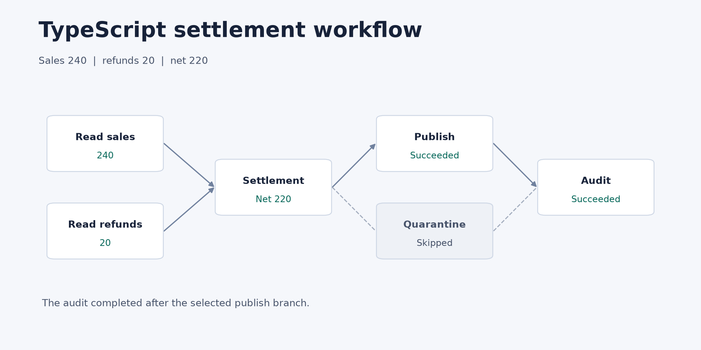
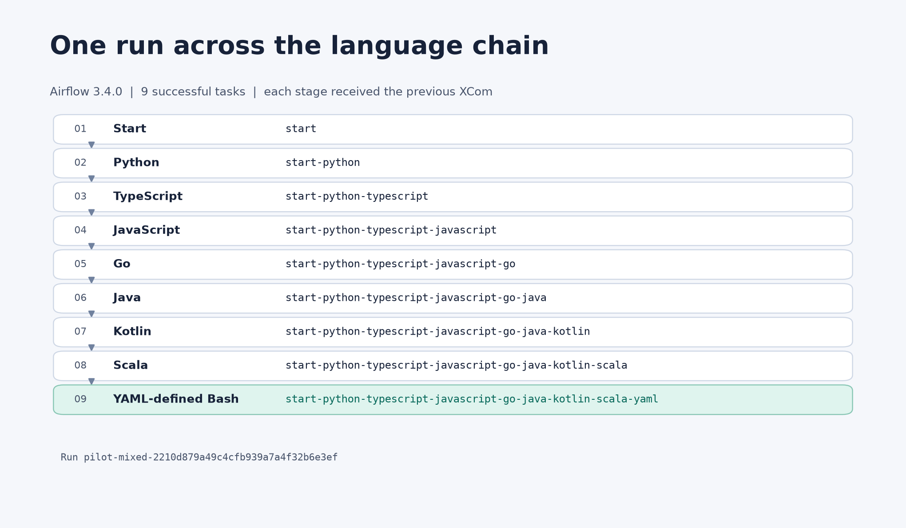

# 배포 및 검증

[English](operations-en.md) / [한국어](operations-ko.md) / [시나리오별 실행기 동작](executors-ko.md)

남은 작업은 [진행 계획](../PLAN-en.md), 실제 실행 근거는 [검증 결과](results-ko.md)에서 확인할 수 있습니다.

## 실험별 통과 기준

E01·E02·E03에서 같은 입력을 사용합니다. 실행 ID를 기록하고, 프로세스·Docker
이벤트·Pod 기록으로 해당 환경의 태스크 격리 방식을 별도로 확인합니다.

| 실험 | 입력 | 통과 기준 |
| --- | --- | --- |
| 기준 DAG | `items=10000`, `shards=1` | `partition`, `sum_squares`, `total`이 성공하고 최종 XCom이 `333283335000`입니다. |
| 회귀형 정산 | 대기 23건, 배치 크기 8 | 태스크 인스턴스 14개가 성공합니다. 3회 반복 후 `23 → 15 → 7 → 0`이 되고 23건을 처리합니다. |
| TypeScript 정산 | 판매액 `[120, 80, 40]`, 환불액 `[15, 5]` | 게시와 감사를 포함한 태스크 6개가 성공하고 `quarantine`은 스킵됩니다. 순액은 `220`입니다. |
| 다중언어 순차 DAG | 시작값 `start` | 태스크 9개가 순서대로 성공하고 각 XCom이 기대값과 일치합니다. |

기대 태스크 상태나 결과값이 다르거나 태스크 격리를 확인할 수 없으면 검증에 실패한 것으로 기록합니다.

## 공통 기준 실험

DAG는 `pilot_portability` 하나를 사용하고 입력은 `items=10000`, `shards=1`로 고정합니다.
DAG는 0부터 9,999까지 각 정수의 제곱을 합산합니다. 최종 XCom의 기댓값은
`333283335000`입니다. Typer 스크립트는 Airflow 엔드포인트 한 곳에 DAG 실행을 한 번
요청하고, 종료 상태와 결과값을 확인한 뒤 실행 ID를 기록합니다. 전체 실험은
[README 검증 표](../README-ko.md#실험별-검증-현황)에서 확인합니다.

모든 환경에서 [`src/dags/`](../src/dags/)의 같은 DAG를 사용합니다. 로컬 이미지는 DAG를 포함합니다. kind는 공식 `apache/airflow:3.4.0` 이미지를 쓰고 기준 DAG를 ConfigMap으로 마운트합니다. 외부 Airflow는 기존 설치 버전을 기록합니다.

스크립트와 노트북은 `src/`에서 Python 3.13 uv 환경으로 실행합니다.
API URL과 Bearer 토큰은 프로세스 환경 변수나 Git에서 제외된 저장소 루트의 `.env`에 둡니다.
스크립트에는 DAG 실행 요청, 실행 이력 조회, XCom 읽기 권한을 부여합니다. 노트북에는
실행 이력과 XCom 읽기 권한을 부여합니다.

## 이식 가능한 DAG 프로필

`scripts/profile.py`는 공개 v2 API를 제공하는 호환 Airflow 3.4 이상에서
사용할 DAG 프로필을 생성하고 검증합니다. 프로필에는 DAG, SHA-256, 추가할
Airflow 설정, 필요한 런타임이 들어갑니다. `baseline`은 기준 Python DAG를
묶습니다. `mixed`는 프로젝트의 다국어 이미지에서 YAML DAG, Node.js,
Go 실행 파일, JRE, JVM 태스크 JAR까지 가져옵니다. 대상 워커와 같은
아키텍처의 Linux 런타임을 사용합니다.

Airflow API에서는 등록된 DAG를 조회하고 실행을 생성합니다. DAG를 배포하려면
대상 환경의 Git 배포 절차를 쓰거나 Kubernetes API로 프로필을 공유 볼륨에
올립니다. Kubernetes 방식에는 공유 볼륨에 쓸 수 있는 전송용 Pod가 필요합니다.
게시한 디렉터리를 DAG 프로세서와 워커의 `mount_path`에 마운트하고, 병합한
설정은 해당 환경의 배포 절차로 반영합니다. 각 DAG ID는 소스 한 곳에만 둡니다.
[Airflow 공개 API](https://airflow.apache.org/docs/apache-airflow/3.4.0/stable-rest-api-ref.html)
· [DAG 번들](https://airflow.apache.org/docs/apache-airflow/3.4.0/administration-and-deployment/dag-bundles.html)

```bash
# src/에서 실행합니다. 빌드마다 새 출력 디렉터리를 사용합니다.
uv run --locked python scripts/profile.py build baseline /tmp/pilot-baseline
uv run --locked python scripts/profile.py build mixed /tmp/pilot-mixed \
  --container pilot-airflow-mixed
uv run --locked python scripts/profile.py settings /tmp/pilot-mixed \
  --existing /path/to/current-airflow-config.json
uv run --locked python scripts/profile.py stage-kubernetes /tmp/pilot-mixed \
  --context YOUR_CONTEXT --namespace YOUR_NAMESPACE --pod YOUR_STAGING_POD \
  --container YOUR_STAGING_CONTAINER --destination /shared/pilot-mixed
```

단기 토큰은 프로세스 환경 변수 `AIRFLOW_PROFILE_TOKEN`으로 전달합니다.
DAG 프로세서가 프로필을 등록하면 실행 ID를 고정해 제출합니다. 같은 ID의
실행이 이미 있으면 조회하며, 조회만 할 때는 `--submit`을 생략합니다.

```bash
uv run --locked python scripts/profile.py run /tmp/pilot-mixed \
  --api-url "$AIRFLOW_URL" --run-id pilot-mixed-external-001 --submit
```

## E01. 로컬 Airflow 컨테이너

공통 이미지를 Docker 컨테이너 하나에서 `airflow standalone`으로 실행합니다.

```bash
docker build -f deploy/Dockerfile -t pilot-airflow-portability:3.4.0 .
bash deploy/local/run.sh
```

로컬 실행 스크립트는 API를 루프백에 바인딩하고 이 실험용 컨테이너에 익명 관리자
접근을 활성화합니다. Chrome에서 `http://127.0.0.1:8080`을 열고,
`pilot_portability` DAG에서 `items=10000`, `shards=1`로 단일 실행을 시작합니다.
DAG와 태스크 세 개가 모두 성공하면 실행 ID를 복사하고 읽기 전용 Typer 명령으로
XCom을 확인합니다.

```bash
cd src
uv sync --locked --extra notebook
export AIRFLOW_LOCAL_URL=http://127.0.0.1:8080
export PILOT_LOCAL_RUN_ID="YOUR_RUN_ID"
AIRFLOW_LOCAL_TOKEN=$(curl -fsS "$AIRFLOW_LOCAL_URL/auth/token" | uv run --locked python -c   'import json, sys; print(json.load(sys.stdin)["access_token"])')
export AIRFLOW_LOCAL_TOKEN
uv run --locked python scripts/experiment.py inspect --target local --run-id "$PILOT_LOCAL_RUN_ID"
```

CLI에서 실행할 경우 Chrome에서 트리거하는 단계 대신 `run --target local`을 사용합니다.
이미 실행했다면 `inspect`로 결과를 확인합니다.

## E02. 로컬 태스크 컨테이너

같은 Dockerfile로 Airflow 이미지를 `pilot-airflow-portability:3.4.0-docker-tasks` 태그로
빌드한 뒤 [`deploy/local/run-docker-task.sh`](../deploy/local/run-docker-task.sh)를
실행합니다. Airflow는 루프백 포트 8086에서 열립니다.
[기준 DAG](../src/dags/portability.py)는 `PILOT_DOCKER_TASK_IMAGE`를 설정하면
`partition`, 매핑된 각 `sum_squares`, `total`을 `DockerOperator(@task.docker)`로 실행합니다.
기본 작업 이미지는 `python:3.13-slim`입니다. 태스크는 결과를 XCom으로 넘기고 실행 후
작업 컨테이너를 제거합니다.
[검증 결과](https://github.com/jyje/pilot-airflow-portability/issues/2)

E02에서 네 DAG를 실행하려면 `mixed` 이미지를 빌드합니다. 각 실행과 Docker 이벤트를
대조할 수 있도록 추가 워크플로우 세 가지는 하나씩 실행합니다.

```bash
docker build --target mixed -f deploy/Dockerfile -t pilot-airflow-portability:e02 .
PILOT_LOCAL_CONTAINER=pilot-airflow-e02-all PILOT_LOCAL_PORT=8094 \
  PILOT_IMAGE=pilot-airflow-portability:e02 bash deploy/local/run-docker-task.sh
```

`AIRFLOW_DOCKER_URL`을 `http://127.0.0.1:8094`로 지정하고 `AIRFLOW_DOCKER_TOKEN`을
환경 변수로 주입합니다. 명령은 `src/`에서 실행합니다.

```bash
uv run --locked python scripts/experiment.py run --target docker
uv run --locked python scripts/experiment.py workflow loop --target docker
uv run --locked python scripts/experiment.py workflow typescript --target docker
uv run --locked python scripts/experiment.py workflow mixed --target docker
```

회귀형 정산은 `DockerOperator`로 작업을 실행합니다. Airflow의 반복 게이트는 종료 조건을
임시 컨테이너에서 계산하고 결과에 따라 반복을 진행합니다. TypeScript, Go, JVM 태스크는
Airflow가 시작한 프로세스의 루프백 중계기를 통해 기존 코디네이터 프로토콜로 통신합니다.
[E02 실행기](../deploy/local/sdk-runtime.py)가 E02 서비스의 네트워크 네임스페이스에서
작업 컨테이너를 만들고 제거합니다.
YAML 체인의 Bash와 Python 명령은 `DockerOperator`로 실행됩니다. 각 실행에서 API 결과와
Docker 컨테이너 생명주기 이벤트를 함께 기록합니다.

## 선택 재현 환경 kind와 Airflow Helm

전용 kind 클러스터를 만들고 [Kubernetes 설치 스크립트](../deploy/kubernetes/install.sh)로
차트 `1.22.0`을 `KubernetesExecutor`와 함께 배포합니다. 스크립트는 기준 DAG의
ConfigMap을 만들고 `portability.py`를 DAG 프로세서와 태스크 Pod에 단일 파일로
마운트합니다. ConfigMap 디렉터리 전체를 마운트하면 Kubernetes가 만든 심볼릭
링크를 Airflow 3.4가 중복 디렉터리로 감지합니다. DAG 소스를 수정한 뒤 설치
스크립트를 다시 실행하면 변경된 파일로 DAG 프로세서가 롤아웃됩니다.
kind 설정은 API 서버와 스케줄러가 시작할 때 최대 6분을 기다립니다. 기준 DAG는
지연 실행 오퍼레이터와 StatsD 메트릭을 사용하지 않아 트리거러와 StatsD를 끕니다.

```bash
kind create cluster --name airflow-pilot --config deploy/kind/cluster.yaml
bash deploy/kubernetes/install.sh kind-airflow-pilot -f deploy/kind/values.yaml
```

외부 검증에 사용한 DAG 파일 그대로 kind에서 재현하려면 해당 커밋의 파일을
추출해 설치 스크립트에 전달합니다.

```bash
dag_dir=$(mktemp -d)
git show 6e7ccbb:src/dags/portability.py > "$dag_dir/portability.py"
PILOT_DAG_FILE="$dag_dir/portability.py" \
  bash deploy/kubernetes/install.sh kind-airflow-pilot -f deploy/kind/values.yaml
```

Airflow API를 루프백으로 포워딩하고 Helm에서 설정한 Airflow 계정으로 토큰을
발급받습니다. `AIRFLOW_KIND_TOKEN`은 셸 환경 변수로 보관합니다.

```bash
kubectl --context kind-airflow-pilot -n airflow-pilot port-forward \
  --address 127.0.0.1 service/airflow-pilot-api-server 8081:8080
```

태스크가 끝나면 작업 Pod가 빠르게 사라질 수 있습니다. 실행을 요청하기 전에
다른 터미널에서 Pod 관찰을 시작합니다.

```bash
kubectl --context kind-airflow-pilot -n airflow-pilot get pods --watch
```

```bash
cd src
export AIRFLOW_KIND_URL=http://127.0.0.1:8081
uv run --locked python scripts/experiment.py run --target kind --items 10000 --shards 1
```

태스크 Pod 3개, 최종 XCom `333283335000`, Airflow 실행 ID를 기록합니다.
[kind 검증 이슈](https://github.com/jyje/pilot-airflow-portability/issues/3)

## E03. 외부 Kubernetes의 기존 Airflow

E03은 기존 배포를 사용합니다. 공식 API는 등록된 DAG의 실행을 요청할 수 있습니다.
기존 git-sync 소스는 `pilot_portability`를 제공합니다. `pilot-e03-dags` ConfigMap은
`reconcile.py`, `settlement.min.mjs`, `chain.yaml`을 제공합니다.
[E03 Helm 값 오버레이](../deploy/kubernetes/e03-values.yaml)는 DAG 프로세서와
Kubernetes 태스크 Pod에 세 파일을 마운트하고, 기존 로그 볼륨에 준비된 Node.js, Go,
JVM 런타임을 연결합니다. 클러스터 저장소가 Helm 값과 ConfigMap을 정의하며, Argo CD가
두 구성을 운영 환경에 동기화합니다. [GitOps 배포 PR](https://github.com/jyje/cluster/pull/423)

기존 Airflow 3.4.0 배포의 기준 실험은 `pilot-e03-current-baseline-20261126`을 사용합니다.
E01·E02에서 검증한 파일과 체크섬이 일치합니다.
[기준 DAG 배포 PR](https://github.com/jyje/pilot-airflow-portability/pull/5)

두 Kubernetes 환경은 같은 공식 Airflow 이미지와 `KubernetesExecutor`를
사용합니다. 기준 실험은 Python 태스크 3개에 `items=10000`, `shards=1`을
명시합니다. kind는 작업 트리의 DAG를 ConfigMap으로 마운트하고, 외부 Airflow는
Git-Sync로 가져온 커밋 `3e31eca`의 DAG를 실행했습니다. 두 Kubernetes 환경은
모두 Python 태스크 실행 경로를 사용합니다.
외부 태스크 Pod는 git-sync init 컨테이너를 사용하고, CPU `50m`와 메모리
`256Mi`를 요청하며 메모리 상한은 `768Mi`입니다. kind 태스크 Pod는
DAG 파일을 직접 마운트하고 컨테이너 리소스 요청이나 상한을 따로 지정하지 않습니다.

기존 Airflow 서비스에 승인된 API 엔드포인트나 포트 포워딩으로 연결합니다.
설치된 Airflow 버전과 Executor를 기록합니다. 실험 스크립트는 Airflow 3 공개 API를
사용하므로, 부여된 권한으로 기준 DAG `pilot_portability`와 XCom에 접근할 수 있는지
확인합니다. DAG가 없다면 해당 인스턴스에서 사용하는 기존 DAG 등록 절차를 따릅니다.

`AIRFLOW_KUBERNETES_URL`과 `AIRFLOW_KUBERNETES_TOKEN`을 설정하고
`src/`에서 기존 실행을 조회합니다.

```bash
uv run --locked python scripts/experiment.py inspect --target kubernetes --run-id pilot-e03-current-baseline-20261126
```

실행 ID, 태스크 상태, 최종 XCom, 기존 배포에서 실제로 사용한 격리 단위를 기록합니다.

태스크 세 개가 각각 별도 워커 Pod에서 동일한 Git 커밋으로 성공했습니다.
실행은 54.84초 걸렸고 최종 XCom은 `333283335000`입니다.
[검증 기록](results-ko.md#e03-외부-kubernetes)

## Jupyter로 결과 비교

[비교 노트북](../src/notebooks/01-compare-airflow.ipynb)을 열고 환경별 기준 DAG 실행 ID 세 개를 입력합니다. 노트북에서 직접 지정하거나 Jupyter 실행 전에
`PILOT_LOCAL_RUN_ID` (E01), `PILOT_DOCKER_RUN_ID` (E02),
`PILOT_KUBERNETES_RUN_ID` (E03)를 설정합니다. 각 Airflow API에서 기존 실행과 XCom 값을 조회합니다. 노트북 조회
결과와 CLI 기록을 대조하고 다음 항목을 남깁니다.

| 항목 | 확인 내용 |
| --- | --- |
| 환경과 실행 ID | 환경별로 기록한 실행 한 건 |
| DAG와 태스크 상태 | E01, E02, E03 모두 성공 |
| 최종 XCom | E01, E02, E03 모두 `333283335000` |
| 소요 시간 | Airflow 시작부터 종료까지의 시간을 단일 실행의 관측값으로 기록 |

연결 실패, 시간 초과, 결과 누락이 있으면 해당 환경에 기록합니다. E01, E02, E03에서 성공 상태와 결과값을 모두 확인하면 실험을 통과합니다.

`src/`에서 `uv run --locked --extra notebook jupyter lab`으로 Jupyter를
시작합니다. 화면 없이 실행하려면 같은 환경 변수를 설정하고 아래 명령을 실행합니다.

```sh
uv run --locked --extra notebook jupyter nbconvert --to notebook --execute \
  --output-dir "$(mktemp -d)" notebooks/01-compare-airflow.ipynb
```

반복 비교는 5회차 동안 회차마다 환경별로 CLI를 한 번씩 실행합니다.
한 실행이 끝난 뒤 다음 실행을 제출하고, 모든 실행에 `items=10000`과
`shards=1`을 사용합니다. 환경별 실행 ID 5개를 회차 순서대로 쉼표로 구분해
`PILOT_LOCAL_RUN_IDS`, `PILOT_DOCKER_RUN_IDS`, `PILOT_KUBERNETES_RUN_IDS`에
설정합니다. Jupyter는 실행별 결과를 검증하고 환경별 소요 시간의 중앙값,
평균, 최솟값, 최댓값을 표시합니다. 캡션에는 E01·E02가 공유하는
로컬 Docker 호스트와 E03의 별도 Kubernetes 리소스를 명시합니다.

실제 실행 결과는 [5회 반복 비교](results-ko.md#기준-dag-5회-반복-비교)에서 확인합니다.

## 추가 워크플로우 실험

동일한 Airflow 3.4.0 이미지에서 워크플로우별로 한 번 실행합니다. 기준 실험을
조회할 수 있도록 루프백 포트 8085에 두 번째 로컬 컨테이너를 띄웁니다. 두 DAG가
Airflow 목록에 표시된 뒤 아래 명령을 실행합니다.

```bash
docker build -f deploy/Dockerfile -t pilot-airflow-portability:3.4.0-workflows .
PILOT_IMAGE=pilot-airflow-portability:3.4.0-workflows PILOT_LOCAL_PORT=8085   PILOT_LOCAL_CONTAINER=pilot-airflow-workflows bash deploy/local/run.sh

cd src
export AIRFLOW_LOCAL_URL=http://127.0.0.1:8085
AIRFLOW_LOCAL_TOKEN=$(curl -fsS "$AIRFLOW_LOCAL_URL/auth/token" | uv run --locked python -c   'import json, sys; print(json.load(sys.stdin)["access_token"])')
export AIRFLOW_LOCAL_TOKEN
uv run --locked python scripts/experiment.py workflow loop --target local
uv run --locked python scripts/experiment.py workflow typescript --target local
```

| DAG | 흐름과 통과 기준 |
| --- | --- |
| `pilot_reconcile` | 미처리 건수 23건으로 시작합니다. Task Loop가 한 번 돌 때마다 최대 8건을 예약·처리하고 남은 건수를 셉니다. 남은 건수가 있으면 게이트가 결과를 다음 반복의 입력으로 전달합니다. 최대 4회 안에 `15 → 7 → 0`으로 정확히 3회 반복하고, 최종 XCom에 23건 처리가 기록되어야 합니다. |
| `pilot_ts_settlement` | 스케줄, 태스크, 의존성을 TypeScript로 정의합니다. 매출과 환불을 각각 읽어 정산 단계에서 합류하고, 게시 또는 격리로 분기한 뒤 선택된 경로가 끝나면 감사 결과를 남깁니다. 매출 240, 환불 20, 순액 220과 함께 게시·감사 성공, 격리 스킵을 확인합니다. |

두 로컬 실행 모두 통과했습니다. Task Loop는 3회 반복해 23건을 모두 처리했습니다
(`23 → 15 → 7 → 0`). TypeScript 정산은 순액 220을 게시하고 감사를 완료했으며
격리 단계는 건너뛰었습니다.





TypeScript DAG 임포터는 이미지에 포함된 Node.js 22와
`@apache-airflow/ts-sdk` 1.0.0을 사용합니다. 빌드에서 타입을 검사하고
`airflow-ts-pack`으로 DAG를 번들링합니다. Airflow 3.4 문서에서는 DAG 임포터를
실험 기능으로 분류합니다.

기존 실행을 조회하려면 Typer 명령에 `--run-id RUN_ID`를 추가합니다. Airflow 화면에서
해당 실행을 선택하고 그래프를 열 수 있습니다. 정산 루프의 Iterations 탭에서는 각 게이트가
반복을 계속하거나 종료한 이유를 확인할 수 있습니다.
[로컬 검증 결과](results-ko.md#e01-로컬-프로세스)

### 다국어 순차 DAG

[`pilot_mixed_language_chain`](../src/dags/mixed/chain.yaml)의
한 실행에서 문자열을 언어 단계별로 이어서 전달합니다.
최초 XCom은 `start`입니다. Python은 `start-python`, TypeScript는
`start-python-typescript`를 넘기고, 나머지 단계도 자기 접미사를 덧붙입니다.

| 단계 순서 | 런타임 또는 선언 방식 |
| --- | --- |
| Python | BashOperator가 시작하는 Python 프로세스 |
| TypeScript, JavaScript | TypeScript SDK로 실행하는 Node.js |
| Go | Go SDK로 빌드한 실행 파일 |
| Java, Kotlin, Scala | Java SDK로 실행하는 JVM |
| YAML로 선언한 Bash | YAML 방식으로 선언한 셸 명령 |

최종 XCom의 기댓값은
`start-python-typescript-javascript-go-java-kotlin-scala-yaml`입니다.
하나의 실행 ID, 모든 중간값, 각 태스크 상태를 기록합니다.
로컬 검증에서 태스크 아홉 개가 모두 성공했고, XCom 아홉 개가 기댓값과
일치했습니다. [실행 기록](results-ko.md#다중언어-순차-dag의-xcom)



다국어 DAG 이미지를 빌드하고 별도 루프백 포트에서 실행합니다.
Airflow 목록에 `pilot_mixed_language_chain`이 표시된 뒤 스크립트를 실행합니다.

```bash
docker build --target mixed -f deploy/Dockerfile -t pilot-airflow-portability:3.4.0-mixed .
PILOT_IMAGE=pilot-airflow-portability:3.4.0-mixed PILOT_LOCAL_PORT=8087 \
  PILOT_LOCAL_CONTAINER=pilot-airflow-mixed bash deploy/local/run.sh

cd src
export AIRFLOW_LOCAL_URL=http://127.0.0.1:8087
AIRFLOW_LOCAL_TOKEN=$(curl -fsS "$AIRFLOW_LOCAL_URL/auth/token" | uv run --locked python -c \
  'import json, sys; print(json.load(sys.stdin)["access_token"])')
export AIRFLOW_LOCAL_TOKEN
uv run --locked python scripts/experiment.py workflow mixed --target local
```

Python 루프와 TypeScript 정산의 로컬 실행 결과는
[검증 결과](results-ko.md#e01-로컬-프로세스)에 기록했습니다.

### Jupyter에서 추가 워크플로우 반복 비교

`uv run --locked python scripts/experiment.py workflow CASE --target TARGET`으로 `loop`,
`typescript`, `mixed`를 환경별로 다섯 번씩 실행합니다. 각 시도의 실험명,
환경(`local`, `docker`, `kubernetes`), 원래 회차와 실행 ID를 기록합니다.
실패하거나 태스크를 재시도한 실행을 특이사항으로 보관하고, 조합마다
첫 시도에 통과한 샘플이 5개가 될 때까지 부족한 회차를 보충합니다.

`src/`에서 `PILOT_WORKFLOW_RUNS`에 [실행 목록](data/workflow-five-runs.jsonl)의
절대 경로를 설정하고 [비교 노트북](../src/notebooks/02-compare-workflows.ipynb)을
엽니다. 각 환경의 URL과 토큰을 설정합니다. E01에서 워크플로우마다 엔드포인트가
다를 경우 해당 `AIRFLOW_LOCAL_<CASE>_URL`과 `AIRFLOW_LOCAL_<CASE>_TOKEN`을
사용합니다. 노트북은 태스크 상태와 XCom을 검증하고 워크플로우별 그래프를 그립니다.

## 참고 자료

- [Airflow 3.4.0 릴리스와 컨테이너 이미지](https://airflow.apache.org/blog/airflow-3.4.0/)
- [Airflow standalone 빠른 시작](https://airflow.apache.org/docs/apache-airflow/3.4.0/start.html)
- [Airflow Helm 차트 1.22.0과 요구 사항](https://airflow.apache.org/docs/helm-chart/1.22.0/)
- [Airflow Task Loops](https://airflow.apache.org/docs/apache-airflow/3.4.0/authoring-and-scheduling/loops.html)
- [Airflow TypeScript SDK](https://airflow.apache.org/docs/apache-airflow/3.4.0/authoring-and-scheduling/language-sdks/typescript.html)
- [Airflow Go SDK](https://airflow.apache.org/docs/apache-airflow/3.4.0/authoring-and-scheduling/language-sdks/go.html)
- [Airflow Java SDK](https://airflow.apache.org/docs/apache-airflow/3.4.0/authoring-and-scheduling/language-sdks/java.html)
- [YAML Dags](https://airflow.apache.org/docs/apache-airflow/stable/authoring-and-scheduling/yaml-dags.html)
