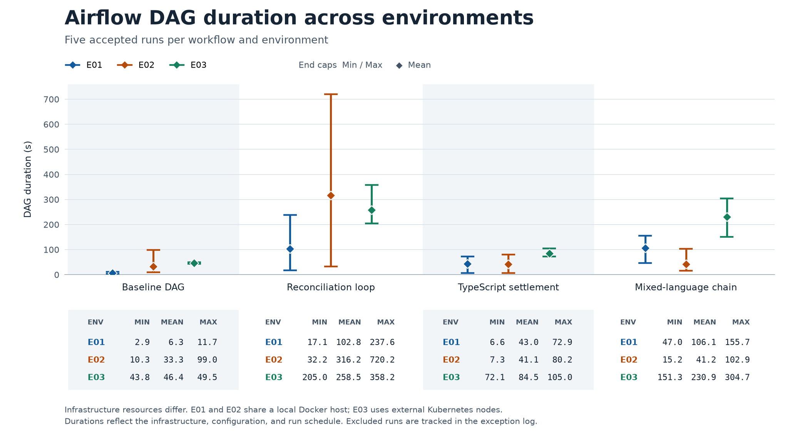
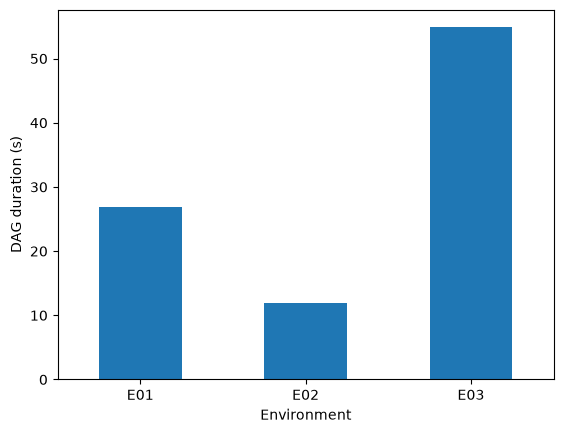
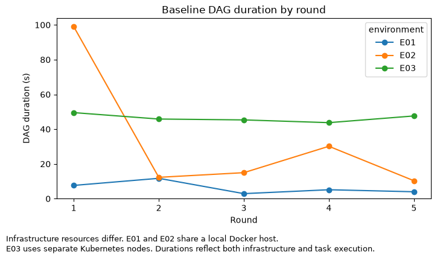
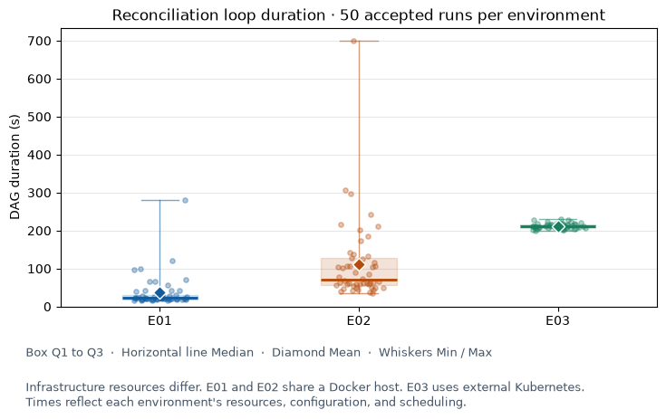
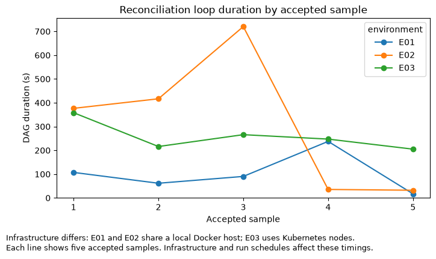
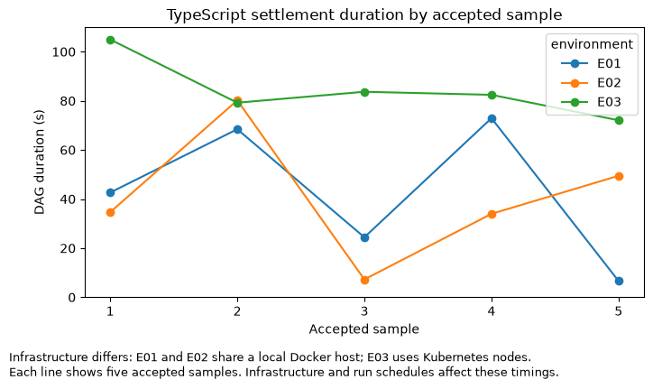
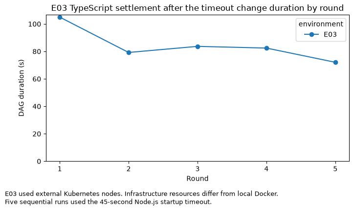
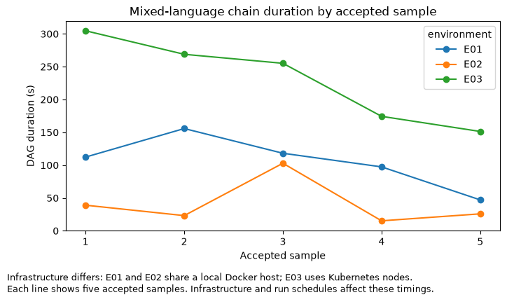
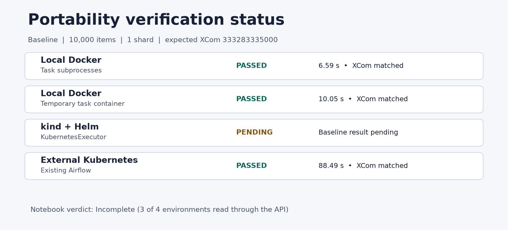
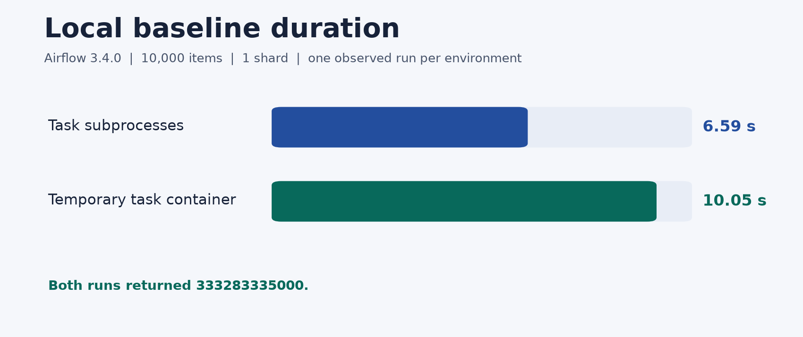

# Verification results

[English](results-en.md) / [한국어](results-ko.md)

All 12 required combinations passed on Airflow 3.4.0. E01 ran task processes in local
Docker, E02 ran workloads in temporary Docker containers, and E03 ran tasks in Pods
on an existing Airflow deployment. kind was optional.

[Reproduction guide](operations-en.md) · [Executor guide](executors-en.md)

## Verification matrix

Each cell contains the successful Airflow run ID. The baseline used
`items=10000` and `shards=1` in all three environments. The baseline and
reconciliation DAG files each matched across all three environments by SHA-256.

| Experiment | E01 | E02 | E03 | Verified result |
| --- | --- | --- | --- | --- |
| Baseline | `pilot-e01-current-baseline-20261126` | `pilot-e02-baseline-suite-20261125` | `pilot-e03-current-baseline-20261126` | 3 successes, final XCom `333283335000` |
| Reconciliation loop | `pilot-e01-current-loop-20261126` | `pilot-e02-isolated-v2-loop-20261125` | `pilot-e03-loop-20261125` | 14 successes, 3 iterations, backlog `23 → 15 → 7 → 0`, 23 processed |
| TypeScript settlement | `pilot-typescript-c135957527b0439182b6c78a4c84df51` | `pilot-e02-isolated-final-typescript-20261125` | `pilot-e03-typescript-20261125` | 6 successes, `quarantine` skipped as expected, net `220` |
| Mixed-language chain | `pilot-mixed-2210d879a49c4cfb939a7a4f32b6e3ef` | `pilot-e02-isolated-final-mixed-20261125` | `pilot-e03-mixed-20261125` | 9 successes, 9 matching XCom values |

## Duration ranges across workflows

Each vertical range shows the minimum and maximum durations of five accepted
runs in one environment. The diamond marks the arithmetic mean. The values
below the chart are in seconds.

*Infrastructure resources differ. E01 and E02 share a local Docker host,
and E03 uses external Kubernetes nodes. The durations reflect the infrastructure,
configuration, and run schedule.*

## Jupyter baseline comparison

Jupyter returned **Passed** after querying the three current baseline runs
through the live Airflow REST APIs. The DAG and its three task instances
(`partition`, `sum_squares`, and `total`) succeeded in each environment.
All runs used `items=10000` and `shards=1` and returned `333283335000`.

| Environment | Run ID | Airflow start-to-end duration |
| --- | --- | ---: |
| E01 | `pilot-e01-current-baseline-20261126` | 26.845 s |
| E02 | `pilot-e02-baseline-suite-20261125` | 11.945 s |
| E03 | `pilot-e03-current-baseline-20261126` | 54.844 s |

Each duration is a single-run observation.
[Comparison notebook](../src/notebooks/01-compare-airflow.ipynb)

*Infrastructure resources differ. E01 and E02 share a local Docker host. E03 uses separate Kubernetes nodes. The observed durations reflect both the infrastructure and task execution.*

## Five-run baseline comparison

The task-attempt audit confirmed all 15 baseline samples passed on their first attempt.

Five fresh runs per environment used `items=10000` and `shards=1`. Each round
submitted E01, E02, then E03, with each run ending before the next was submitted.
All 15 runs and all 45 task instances passed. Jupyter matched the CLI run IDs
and results. Every final XCom was `333283335000`. Durations cover the Airflow
DAG start-to-end interval. All five observations per environment are included.

| Environment | Runs | Median (s) | Mean (s) | Min (s) | Max (s) |
| --- | ---: | ---: | ---: | ---: | ---: |
| E01 | 5 | 5.147 | 6.276 | 2.904 | 11.717 |
| E02 | 5 | 14.969 | 33.343 | 10.320 | 98.988 |
| E03 | 5 | 45.830 | 46.407 | 43.750 | 49.526 |

*Infrastructure resources differ. E01 and E02 share a local Docker host, with task processes in E01 and temporary workload containers in E02. E03 runs task Pods on separate Kubernetes nodes. The observed durations reflect both the infrastructure and task execution.*

| Round | Environment | Run ID | Duration (s) |
| ---: | --- | --- | ---: |
| 1 | E01 | `pilot-b0ab2b729d4c4656916a2a0f1b6c3fad` | 7.632 |
| 1 | E02 | `pilot-4f3a2541c00e4ed899bce7e1ed28f682` | 98.988 |
| 1 | E03 | `pilot-174a251f3ea84bcc9bf26530afb38488` | 49.526 |
| 2 | E01 | `pilot-b5bc50dc05d24f62b4a1e29dbcd8f346` | 11.717 |
| 2 | E02 | `pilot-db0f3e28b3924a00930e9f2608fec85a` | 12.286 |
| 2 | E03 | `pilot-785d05071cd64c928602e7e57947fde3` | 45.830 |
| 3 | E01 | `pilot-b838804d49d24551a7b447c468a6ed7a` | 2.904 |
| 3 | E02 | `pilot-6e9b726cccd0422ab9b12cd6755fba0d` | 14.969 |
| 3 | E03 | `pilot-f86e997eebcc445691dc41c942097f21` | 45.328 |
| 4 | E01 | `pilot-1aa54e133e354d8c8162d9193a74fc20` | 5.147 |
| 4 | E02 | `pilot-3ce08e7980d6481eaee7a4010c26b9b2` | 30.151 |
| 4 | E03 | `pilot-2afbf1aaea9e4951aa344853340b6d63` | 43.750 |
| 5 | E01 | `pilot-14f96c3e442c4cbd85d6f0b98da42a45` | 3.980 |
| 5 | E02 | `pilot-6b96b0bdaa484270b1766b003b4cb6e9` | 10.320 |
| 5 | E03 | `pilot-24012e1a89cf42c8befc470864662f77` | 47.603 |

## Reconciliation loop with 50 samples per environment

The dedicated series collected 50 first-attempt successes each in E01, E02,
and E03. A run passed when all 14 task instances succeeded on their first
attempt and the final XCom reported 23 processed records and backlog
23 → 15 → 7 → 0. Durations measure Airflow DAG start to end. The E01 and E02
series alternated on their shared Docker host. E03 ran sequentially on
external Kubernetes while the local series progressed independently.
All three loaded DAG source files had the same SHA-256. Idle pilot
containers were stopped partway through the local series. The sample
data records which services had stopped at the start and during each run.
The earlier five-run comparison is recorded separately below.

The box covers Q1 to Q3 and the line marks the median. The diamond marks
the mean and the whiskers span the observed minimum and maximum. The 95%
interval for the mean uses 10,000 bootstrap resamples within each
environment and treats individual runs as independent.

*Infrastructure resources differ. E01 and E02 share local Docker resources
and E03 uses external Kubernetes nodes. Timings include the effect of each
environment's configuration, resources, and scheduling.*

| Environment | Accepted / attempts | Min (s) | Q1 (s) | Median (s) | Q3 (s) | Mean (s) | 95% mean CI (s) | Max (s) |
| --- | ---: | ---: | ---: | ---: | ---: | ---: | --- | ---: |
| E01 | 50 / 50 | 15.319 | 19.560 | 22.433 | 31.043 | 36.788 | 27.222 to 50.253 | 280.747 |
| E02 | 50 / 50 | 35.546 | 56.892 | 70.158 | 127.658 | 112.364 | 86.548 to 144.506 | 699.572 |
| E03 | 50 / 50 | 200.085 | 206.799 | 211.564 | 216.688 | 212.324 | 210.386 to 214.334 | 231.656 |

The exception log is empty because no attempts were excluded.
First-attempt successes are included regardless of duration.

[Timing samples](data/reconciliation-50-samples.jsonl) ·
[Exception log](data/reconciliation-50-exceptions.jsonl) ·
[Jupyter notebook](../src/notebooks/03-compare-reconciliation.ipynb)

## Five-run workflow comparisons

Each environment and workflow has **five first-attempt samples**. All 45
passed the CLI checks and the Jupyter recheck. Runs with failures, retries, or execution
interruptions are recorded under [exceptions](#excluded-runs). First-attempt successes
were kept regardless of duration. The sample number lists the retained runs
first and replacement runs last. The manifest preserves the source round
and Airflow start and end times. Later local replacements ran while unused
pilot containers were temporarily stopped.

[Accepted run IDs and timings (JSONL)](data/workflow-five-runs.jsonl) ·
[Jupyter notebook](../src/notebooks/02-compare-workflows.ipynb)

### Reconciliation loop

*Infrastructure differs. E01 and E02 share a local Docker host, and E03 uses
external Kubernetes nodes. Some original executions overlapped. Replacement
runs were serial on the local host and within E03.*

| Environment | Samples | Median (s) | Mean (s) | Min (s) | Max (s) |
| --- | ---: | ---: | ---: | ---: | ---: |
| E01 | 5 | 90.352 | 102.778 | 17.089 | 237.617 |
| E02 | 5 | 376.520 | 316.247 | 32.219 | 720.162 |
| E03 | 5 | 247.264 | 258.494 | 205.027 | 358.221 |

### TypeScript settlement

*Infrastructure differs. E01 and E02 share a local Docker host, and E03 uses
external Kubernetes nodes. Some original executions overlapped. Replacement
runs were serial on the local host and within E03.*

| Environment | Samples | Median (s) | Mean (s) | Min (s) | Max (s) |
| --- | ---: | ---: | ---: | ---: | ---: |
| E01 | 5 | 42.632 | 43.003 | 6.626 | 72.913 |
| E02 | 5 | 34.633 | 41.101 | 7.257 | 80.195 |
| E03 | 5 | 82.430 | 84.474 | 72.070 | 104.975 |

#### E03 retest after the Node.js timeout change

[Cluster PR #426](https://github.com/jyje/cluster/pull/426) set the Node.js
runtime startup timeout to 45 seconds. Argo CD synced the change to E03.
The earlier 10-second series is listed under [exceptions](#excluded-runs). Five fresh TypeScript settlement runs were submitted one at a time.
**5/5 passed** the CLI and Jupyter checks. In each passing run, six tasks
succeeded, `quarantine` skipped, and the settlement XCom returned net `220`.

| Round | Run ID | Result | Duration (s) |
| ---: | --- | --- | ---: |
| 1 | `pilot-node45-xvonds-e03-typescript-01` | Passed | 104.975 |
| 2 | `pilot-node45-xvonds-e03-typescript-02` | Passed | 79.224 |
| 3 | `pilot-node45-xvonds-e03-typescript-03` | Passed | 83.671 |
| 4 | `pilot-node45-xvonds-e03-typescript-04` | Passed | 82.430 |
| 5 | `pilot-node45-xvonds-e03-typescript-05` | Passed | 72.070 |

*This series used external Kubernetes nodes. E03 infrastructure resources
differ from the local Docker scenarios. The chart shows elapsed Airflow DAG
times from five sequential runs using the 45-second timeout.*

### Mixed-language chain

*Infrastructure differs. E01 and E02 share a local Docker host, and E03 uses
external Kubernetes nodes. Some original executions overlapped. Replacement
runs were serial on the local host and within E03.*

| Environment | Samples | Median (s) | Mean (s) | Min (s) | Max (s) |
| --- | ---: | ---: | ---: | ---: | ---: |
| E01 | 5 | 112.255 | 106.093 | 47.025 | 155.738 |
| E02 | 5 | 25.791 | 41.182 | 15.179 | 102.878 |
| E03 | 5 | 255.143 | 230.863 | 151.288 | 304.702 |

The E03 mixed-language series retains 3 observations with the 10-second Node.js limit. The remaining 2 used the 45-second setting.

### Excluded runs

**25 runs** were excluded from the sample statistics and charts.
The five original E03 TypeScript settlement runs and E03 mixed-language
attempts 2 and 5 hit the Node.js 10-second connection limit. The original E02 mixed-language
attempt 1 hit the 45-second startup limit in Scala. The E02 scheduler also
stopped on SQLite locking errors during replenishment. The local metadata
database was backed up, WAL was confirmed, and the sync and async connection
lock wait was set to 60 seconds. The accepted manifest marks the samples
collected after that adjustment.
[Airflow database configuration](https://airflow.apache.org/docs/apache-airflow/3.4.0/configurations-ref.html#sql-alchemy-connect-args)

[Excluded run details (JSONL)](data/workflow-sample-exceptions.jsonl)

| Experiment | Environment | Source attempt | Run ID | Failed or retried tasks / other error |
| --- | --- | ---: | --- | --- |
| Reconciliation loop | E01 | 3 | `pilot-five-wn1swt-e01-loop-03` | `load_backlog` |
| Reconciliation loop | E02 | 2 | `pilot-five-wn1swt-e02-loop-02` | `reconcile_batch.reserve_batch` |
| TypeScript settlement | E01 | 2 | `pilot-five-wn1swt-e01-typescript-02` | `audit` |
| TypeScript settlement | E01 | 3 | `pilot-five-wn1swt-e01-typescript-03` | `can_publish` |
| TypeScript settlement | E01 | 4 | `pilot-five-wn1swt-e01-typescript-04` | `reconcile` |
| TypeScript settlement | E01 | 5 | `pilot-five-wn1swt-e01-typescript-05` | `can_publish` |
| TypeScript settlement | E02 | 2 | `pilot-five-wn1swt-e02-typescript-02` | `reconcile` |
| TypeScript settlement | E02 | 4 | `pilot-five-wn1swt-e02-typescript-04` | `collect.sales`, `collect.refunds` |
| TypeScript settlement | E03 | 1 | `pilot-five-wn1swt-e03-typescript-01` | `collect.sales`, `collect.refunds` |
| TypeScript settlement | E03 | 2 | `pilot-five-wn1swt-e03-typescript-02` | `collect.sales`, `collect.refunds` |
| TypeScript settlement | E03 | 3 | `pilot-five-wn1swt-e03-typescript-03` | `publish` |
| TypeScript settlement | E03 | 4 | `pilot-five-wn1swt-e03-typescript-04` | `collect.sales` |
| TypeScript settlement | E03 | 5 | `pilot-five-wn1swt-e03-typescript-05` | `collect.sales` |
| Mixed-language chain | E01 | 4 | `pilot-five-wn1swt-e01-mixed-04` | `java` |
| Mixed-language chain | E02 | 1 | `pilot-five-wn1swt-e02-mixed-01` | `scala` |
| Mixed-language chain | E02 | 2 | `pilot-five-wn1swt-e02-mixed-02` | `python` |
| Mixed-language chain | E02 | 3 | `pilot-five-wn1swt-e02-mixed-03` | `javascript`, `python` |
| Mixed-language chain | E03 | 2 | `pilot-five-wn1swt-e03-mixed-02` | `typescript` |
| Mixed-language chain | E03 | 5 | `pilot-five-wn1swt-e03-mixed-05` | `typescript` |
| Mixed-language chain | E02 | 1 | `pilot-clean-swotej-e02-mixed-01` | Scheduler stopped; local Airflow restarted |
| Mixed-language chain | E02 | 2 | `pilot-clean-swotej-e02-mixed-02` | `python` |
| TypeScript settlement | E02 | 1 | `pilot-clean-swotej-e02-typescript-01` | `collect.sales`, `collect.refunds` |
| TypeScript settlement | E02 | 2 | `pilot-clean-swotej-e02-typescript-02` | `collect.sales`, `collect.refunds` |
| TypeScript settlement | E02 | 4 | `pilot-clean-swotej-e02-typescript-04` | Scheduler stopped; local Airflow restarted |
| TypeScript settlement | E02 | 5 | `pilot-clean-swotej-e02-typescript-05` | `can_publish` |

## Local verification

E01 ran the baseline and reconciliation rechecks on a single Airflow host on
2026-11-26. The initial Chrome run, `pilot-local-20261123`, finished in 6.59 s.
The Typer CLI and Jupyter read that run through the REST API and confirmed the
result. [Issue #1](https://github.com/jyje/pilot-airflow-portability/issues/1)

## Additional local workflow verification

The first E01 reconciliation run, `pilot-loop-e6bf9cf0a6ce45198b2fbf3ac632b3ab`,
completed three iterations and processed all 23 records. The TypeScript
settlement on Node.js 22 with the TypeScript SDK 1.0.0 reported sales of 240,
refunds of 20, and net proceeds of 220. Publishing and auditing succeeded.

### Mixed-language run evidence

Typer confirmed each sequential stage and intermediate XCom in the E01 run.
The first task hit a 5-second Execution API timeout. Increasing it to 45
seconds and clearing tasks under the same run ID resolved the error.

| Successful stage | XCom |
| --- | --- |
| Start | `start` |
| Python | `start-python` |
| TypeScript | `start-python-typescript` |
| JavaScript | `start-python-typescript-javascript` |
| Go | `start-python-typescript-javascript-go` |
| Java | `start-python-typescript-javascript-go-java` |
| Kotlin | `start-python-typescript-javascript-go-java-kotlin` |
| Scala | `start-python-typescript-javascript-go-java-kotlin-scala` |
| YAML-defined Bash | `start-python-typescript-javascript-go-java-kotlin-scala-yaml` |

## Local task-container verification

Docker recorded a distinct workload container for every successful E02 task
instance. Each container was created, started, exited with code 0, and was
removed. [Issue #2](https://github.com/jyje/pilot-airflow-portability/issues/2)

- The baseline finished in 11.945 s. Container IDs were `849bc1425989` for
  `partition`, `8cf190752671` for `sum_squares`, and `ac252f18cb52` for `total`.
- The loop used 14 containers, one each for `load_backlog` and `summarize` and
  three each for `reserve_batch`, `apply_batch`, `measure`, and `backlog_empty`.
  Airflow's loop gate used the predicate result to continue or finish the loop.
- Settlement used six Node.js containers. The mixed-language chain used three
  shell or Python containers, two Node.js containers, one Go container, and
  three JVM containers. A local relay kept SDK supervisor connections under the
  launcher process that Airflow started.

### Earlier E02 runs

- `pilot-4078c1f70af2491184c20ff745bd5c2b` failed during supervisor startup.
  Switching to a Python-only workload image let
  `pilot-efe610c165694acd9de7e8d1c297d825` verify `sum_squares` in container
  `d629787584f9` and finish in 10.05 s.
- `pilot-e02-baseline-20261125` hit an `items` template lookup error.
  `pilot-e02-baseline-fixed-20261125` corrected it and hit a 30-second DAG
  import timeout. The successful all-task run used four LocalExecutor slots
  and longer import and Execution API timeouts.
- `pilot-e02-loop-20261125`, `pilot-e02-typescript-20261125`, and
  `pilot-e02-mixed-20261125` established the expected outputs. The final runs
  in the matrix verified per-task container isolation. Direct SDK connections
  in an earlier mixed-language attempt were rejected by the Airflow supervisor.

A live Jupyter check matched the local E01 and E02 baseline results and
reported `Incomplete` with two endpoints configured. An earlier notebook run
included the original E03 baseline under the former scope that also included
kind.

## External Kubernetes verification

E03 reused the existing Airflow 3.4.0 deployment with Helm 1.22.0 and
KubernetesExecutor. Git-Sync provided the baseline. ConfigMap `pilot-e03-dags`
provided `reconcile.py`, `settlement.min.mjs`, and `chain.yaml` in bundle
`pilot-e03`. The DAG processor and task Pod template mounted these files and
used the staged ARM64 runtimes on the logs volume. Argo CD reported both the
Airflow and parent applications `Synced` and `Healthy` after the changes.
[Rollout record](https://github.com/jyje/cluster/issues/407#issuecomment-7123043608)
· [Cluster PR #423](https://github.com/jyje/cluster/pull/423)
· [E03 overlay](../deploy/kubernetes/e03-values.yaml)

| Experiment | Successful task Pods | Observed duration |
| --- | ---: | ---: |
| Baseline | 3 | 54.84 s |
| Reconciliation loop | 14 | 223.23 s |
| TypeScript settlement | 6 | 74.63 s after retry |
| Mixed-language chain | 9 | 96.69 s after the final retry |

- All three baseline task Pods pulled Git commit
  `3e31ecaaf8cce3eb20c5815451d014cc0455d0be`. Airflow parsed DAG version 2.
  [Pilot PR #5](https://github.com/jyje/pilot-airflow-portability/pull/5)
- Both TypeScript collectors hit a 10-second runtime connection timeout.
  Clearing failed and upstream-failed tasks retried them under the same run ID.
- Two Java attempts hit the 10-second JVM connection timeout. Increasing it to
  45 seconds and clearing failed and upstream-failed tasks preserved the first
  five successful stages and their XCom values.
  [Cluster PR #425](https://github.com/jyje/cluster/pull/425)
- `raspi-50` ran 4 of the 32 successful task Pods and `raspi-51` ran 28.
  All four Pods from the failed attempts ran on `raspi-51`.
  [Task-to-node tables (English)](https://github.com/jyje/pilot-airflow-portability/blob/main/docs/e03-node-placement-en.md)
  · [태스크별 노드 배치 (한국어)](https://github.com/jyje/pilot-airflow-portability/blob/main/docs/e03-node-placement-ko.md)

### Before ConfigMap registration

Airflow listed the original baseline from Git-Sync at commit `6e7ccbb`.
Typer confirmed that run `pilot-verify-1795494928` finished in 88.49 s, used
three distinct worker Pod hostnames, and returned `333283335000`.

The public API starts a run for a registered DAG ID. The parse endpoint takes
an existing file token. The additional DAGs became available after Airflow
parsed the files delivered through the GitOps-managed ConfigMap.
[Airflow REST API](https://airflow.apache.org/docs/apache-airflow/3.4.0/stable-rest-api-ref.html)
· [DAG bundles](https://airflow.apache.org/docs/apache-airflow/3.4.0/administration-and-deployment/dag-bundles.html)

## Optional kind reproduction

The official Airflow 3.4.0 image and Helm chart 1.22.0 registered the baseline
after the installer switched to a single-file ConfigMap `subPath` mount and
rolled the DAG processor. An API read timeout prevented confirmation of
submission for `pilot-b80b1e60afa745318d94d87a575c04af`. The metadata database
had no record of that ID. A fresh cluster passed short readiness and ConfigMap
checks, then its etcd readiness and Kubernetes API failed under Helm migration
load. No baseline run was recorded.
[Issue #3](https://github.com/jyje/pilot-airflow-portability/issues/3)

For a future reproduction, set `PILOT_DAG_FILE` to the baseline revision listed
in the E03 evidence so the run uses the same DAG source.

## Historical snapshot

The November 24, 2026 comparison included kind. The duration chart shows one
observed baseline run per local Docker scenario at the time.

