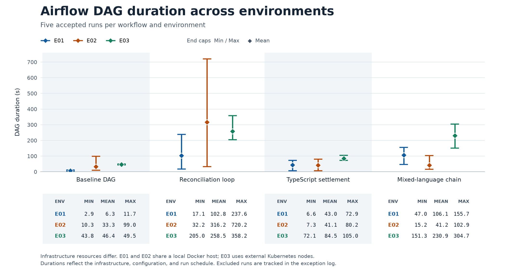
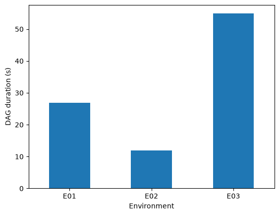
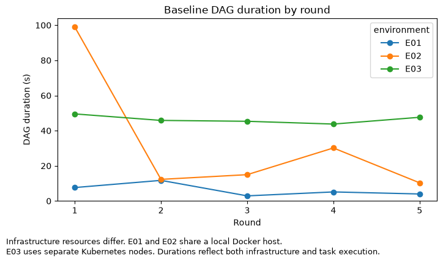
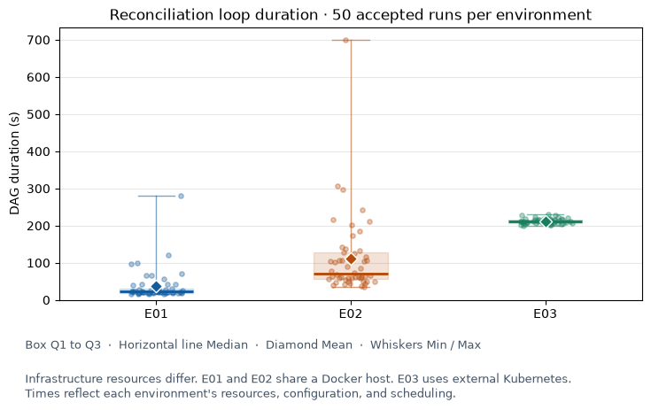
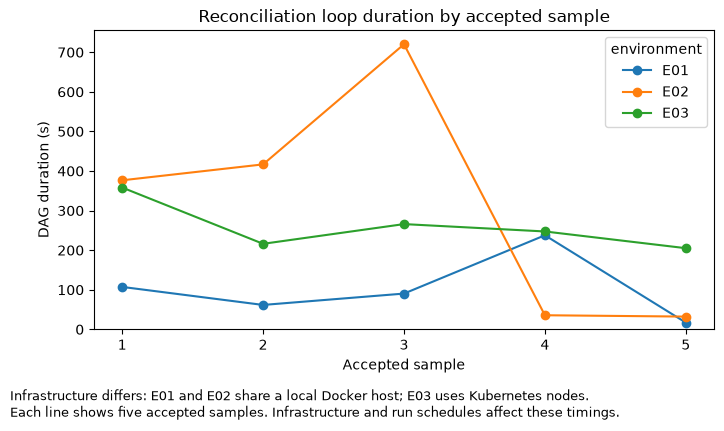
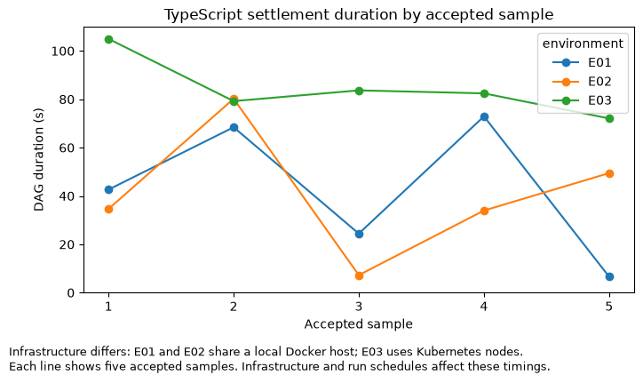
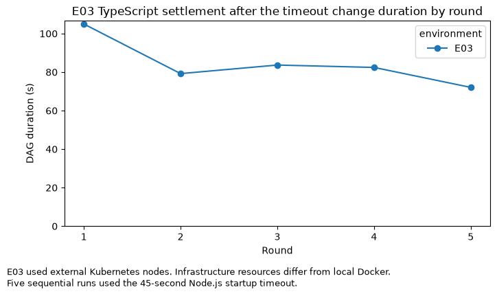
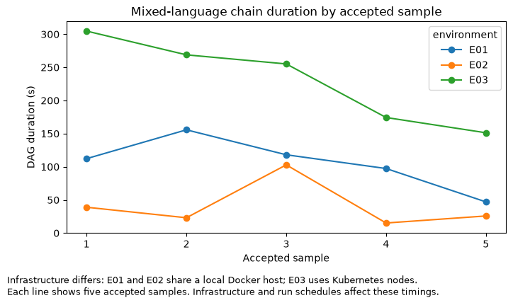
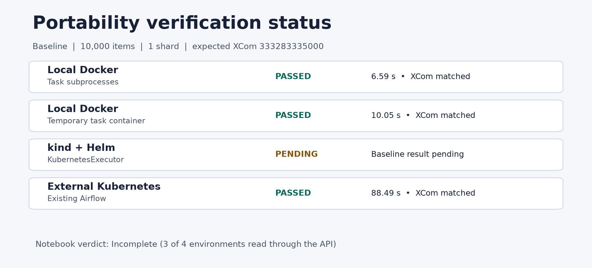
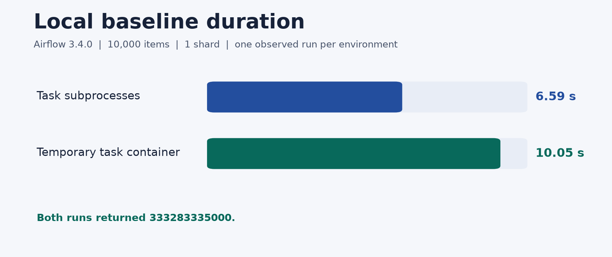

# 검증 결과

[English](results-en.md) / [한국어](results-ko.md)

Airflow 3.4.0에서 필수 조합 12개가 모두 통과했습니다. E01은 로컬 Docker의
Airflow 프로세스에서, E02는 태스크별 임시 Docker 컨테이너에서, E03은
기존 Airflow가 생성한 Kubernetes 태스크 Pod에서 실행했습니다. kind는 선택 재현 환경입니다.

[재현 가이드](operations-ko.md) · [실행기 가이드](executors-ko.md)

## 실험별 실행 ID

기준 실험은 세 환경에서 `items=10000`, `shards=1`로 수행했습니다.
기준 DAG와 회귀형 정산 DAG는 각각 세 환경에서 파일의 SHA-256이 일치했습니다.

| 실험 | E01 | E02 | E03 | 확인한 결과 |
| --- | --- | --- | --- | --- |
| 기준 DAG | `pilot-e01-current-baseline-20261126` | `pilot-e02-baseline-suite-20261125` | `pilot-e03-current-baseline-20261126` | 태스크 3개 성공, 최종 XCom `333283335000` |
| 회귀형 정산 | `pilot-e01-current-loop-20261126` | `pilot-e02-isolated-v2-loop-20261125` | `pilot-e03-loop-20261125` | 태스크 인스턴스 14개 성공, 3회 반복, `23 → 15 → 7 → 0`, 23건 처리 |
| TypeScript 정산 | `pilot-typescript-c135957527b0439182b6c78a4c84df51` | `pilot-e02-isolated-final-typescript-20261125` | `pilot-e03-typescript-20261125` | 태스크 6개 성공, `quarantine` 스킵, 순액 `220` |
| 다중언어 순차 DAG | `pilot-mixed-2210d879a49c4cfb939a7a4f32b6e3ef` | `pilot-e02-isolated-final-mixed-20261125` | `pilot-e03-mixed-20261125` | 태스크 9개 성공, XCom 9개 일치 |

## 실험별 소요 시간 요약

세로선의 양끝은 한 환경에서 채택한 실행 5개의 최솟값과 최댓값이고,
마름모는 산술평균입니다. 그림 아래의 수치는 초 단위입니다.

*인프라 리소스가 다릅니다. E01·E02는 로컬 Docker 호스트를 공유하며
E03은 외부 Kubernetes 노드를 사용합니다. 소요 시간에는 인프라, 구성,
실행 일정의 차이가 함께 반영됩니다.*

## Jupyter 기준 실험 비교

실제 Airflow REST API에서 세 환경의 기준 실행을 조회한 결과,
Jupyter 판정은 **통과**였습니다. 세 환경 모두 DAG와
`partition`, `sum_squares`, `total`이 성공했습니다.
입력은 `items=10000`, `shards=1`, 최종 XCom은 `333283335000`으로 일치했습니다.

| 환경 | 실행 ID | Airflow 시작부터 종료까지 |
| --- | --- | ---: |
| E01 | `pilot-e01-current-baseline-20261126` | 26.845초 |
| E02 | `pilot-e02-baseline-suite-20261125` | 11.945초 |
| E03 | `pilot-e03-current-baseline-20261126` | 54.844초 |

각 소요 시간은 단일 실행의 관측값입니다.
[비교 노트북](../src/notebooks/01-compare-airflow.ipynb)

*환경별 인프라 리소스가 다릅니다. E01·E02는 로컬 Docker 호스트를 공유하고 E03은 별도 Kubernetes 노드를 사용합니다. 관측 시간에는 인프라와 태스크 실행 방식의 차이가 함께 반영됩니다.*

## 기준 DAG 5회 반복 비교

기준 DAG 15개 샘플은 태스크 시도 기록에서도 모두 첫 시도 통과를 확인했습니다.

각 환경에서 `items=10000`, `shards=1`로 다섯 번씩 새로 실행했습니다.
매 회차에 E01, E02, E03 순으로 진행했고, 앞선 실행이 끝난 뒤 다음 실행을
제출했습니다. DAG 실행 15건과 태스크 인스턴스 45개가 모두 성공했습니다.
CLI와 Jupyter에서 확인한 실행 ID와 결과가 일치했고, 최종 XCom은
모두 `333283335000`이었습니다. Airflow DAG 시작부터 종료까지의 시간을
측정했고, 환경별 관측값 다섯 개를 모두 집계했습니다.

| 환경 | 실행 횟수 | 중앙값(초) | 평균(초) | 최솟값(초) | 최댓값(초) |
| --- | ---: | ---: | ---: | ---: | ---: |
| E01 | 5 | 5.147 | 6.276 | 2.904 | 11.717 |
| E02 | 5 | 14.969 | 33.343 | 10.320 | 98.988 |
| E03 | 5 | 45.830 | 46.407 | 43.750 | 49.526 |

*환경별 인프라 리소스가 다릅니다. E01·E02는 로컬 Docker 호스트를 공유하며, E01은 태스크 프로세스, E02는 임시 워크로드 컨테이너에서 실행됩니다. E03은 별도 Kubernetes 노드의 태스크 Pod에서 실행됩니다. 관측 시간에는 인프라와 태스크 실행 방식의 차이가 함께 반영됩니다.*

| 회차 | 환경 | 실행 ID | 소요 시간(초) |
| ---: | --- | --- | ---: |
| 1 | E01 | `pilot-b0ab2b729d4c4656916a2a0f1b6c3fad` | 7.632 |
| 1 | E02 | `pilot-4f3a2541c00e4ed899bce7e1ed28f682` | 98.988 |
| 1 | E03 | `pilot-174a251f3ea84bcc9bf26530afb38488` | 49.526 |
| 2 | E01 | `pilot-b5bc50dc05d24f62b4a1e29dbcd8f346` | 11.717 |
| 2 | E02 | `pilot-db0f3e28b3924a00930e9f2608fec85a` | 12.286 |
| 2 | E03 | `pilot-785d05071cd64c928602e7e57947fde3` | 45.830 |
| 3 | E01 | `pilot-b838804d49d24551a7b447c468a6ed7a` | 2.904 |
| 3 | E02 | `pilot-6e9b726cccd0422ab9b12cd6755fba0d` | 14.969 |
| 3 | E03 | `pilot-f86e997eebcc445691dc41c942097f21` | 45.328 |
| 4 | E01 | `pilot-1aa54e133e354d8c8162d9193a74fc20` | 5.147 |
| 4 | E02 | `pilot-3ce08e7980d6481eaee7a4010c26b9b2` | 30.151 |
| 4 | E03 | `pilot-2afbf1aaea9e4951aa344853340b6d63` | 43.750 |
| 5 | E01 | `pilot-14f96c3e442c4cbd85d6f0b98da42a45` | 3.980 |
| 5 | E02 | `pilot-6b96b0bdaa484270b1766b003b4cb6e9` | 10.320 |
| 5 | E03 | `pilot-24012e1a89cf42c8befc470864662f77` | 47.603 |

## 회귀형 정산 환경별 50회 비교

E01·E02·E03 각각에서 첫 시도에 통과한 실행 50개를 수집했습니다.
태스크 인스턴스 14개가 첫 시도에 성공하고 최종 XCom에 23건 처리와
대기 건수 23 → 15 → 7 → 0이 기록된 실행을 채택했습니다. 소요 시간은
Airflow DAG의 시작부터 종료까지입니다. 같은 Docker 호스트의 E01·E02는
교대로 실행했고, E03은 외부 Kubernetes에서 별도의 순차 실행으로 진행했습니다.
세 환경에서 읽은 DAG 파일의 SHA-256은 같았습니다. 로컬 반복 중 기존
유휴 파일럿 컨테이너를 일시 중지했고, 각 실행 시작 시점과 도중에 어떤
서비스가 중지됐는지 샘플 데이터에 기록했습니다. 기존 5회 비교는 아래에
별도 기록했습니다.

상자는 Q1부터 Q3까지이고 선은 중앙값입니다. 마름모는 평균이고 수염의
양끝은 관측 최솟값과 최댓값입니다. 평균의 95% 신뢰구간은 각 환경에서
개별 실행을 독립으로 가정해 10,000회 부트스트랩으로 추정했습니다.

*인프라 리소스가 다릅니다. E01·E02는 로컬 Docker 리소스를 공유하고
E03은 외부 Kubernetes 노드를 사용합니다. 관측 시간에는 각 환경의
구성, 리소스, 실행 일정이 함께 반영됩니다.*

| 환경 | 채택 / 전체 시도 | 최솟값(초) | Q1(초) | 중앙값(초) | Q3(초) | 평균(초) | 평균 95% 신뢰구간(초) | 최댓값(초) |
| --- | ---: | ---: | ---: | ---: | ---: | ---: | --- | ---: |
| E01 | 50 / 50 | 15.319 | 19.560 | 22.433 | 31.043 | 36.788 | 27.222~50.253 | 280.747 |
| E02 | 50 / 50 | 35.546 | 56.892 | 70.158 | 127.658 | 112.364 | 86.548~144.506 | 699.572 |
| E03 | 50 / 50 | 200.085 | 206.799 | 211.564 | 216.688 | 212.324 | 210.386~214.334 | 231.656 |

제외한 회차가 없어 특이사항 파일은 비어 있습니다.
첫 시도에 통과한 실행은 소요 시간과 관계없이 포함했습니다.

[소요 시간 샘플](data/reconciliation-50-samples.jsonl) ·
[특이사항](data/reconciliation-50-exceptions.jsonl) ·
[Jupyter 노트북](../src/notebooks/03-compare-reconciliation.ipynb)

## 추가 워크플로우 5회 반복 비교

환경과 워크플로우 조합마다 **첫 시도에 통과한 샘플 5개**를 집계했습니다.
채택한 45개 실행은 CLI와 Jupyter로 다시 확인했습니다. 실패·태스크 재시도·실행 중단이 발생한 회차는 [특이사항](#특이사항)에 기록했습니다. 첫 시도에 통과한
실행은 소요 시간과 관계없이 유지했습니다. 샘플 번호는 기존 정상 실행 뒤에
보충 실행을 배치한 순서이며, JSONL에는 원래 회차와 Airflow 시작·종료 시각도 남겼습니다.
후반 로컬 보충 중에는 실행이 없는 기존 파일럿 컨테이너를 잠시 중지했습니다.

[채택한 실행 ID 및 소요 시간 (JSONL)](data/workflow-five-runs.jsonl) ·
[Jupyter 노트북](../src/notebooks/02-compare-workflows.ipynb)

### 회귀형 정산

*환경별 인프라 리소스가 다릅니다. E01·E02는 로컬 Docker 호스트를 공유하고
E03은 외부 Kubernetes 노드를 사용합니다. 기존 실행 중 일부는 서로 겹쳤으며,
보충 실행은 로컬 호스트와 E03 각각에서 순차로 수행했습니다.*

| 환경 | 샘플 | 중앙값(초) | 평균(초) | 최솟값(초) | 최댓값(초) |
| --- | ---: | ---: | ---: | ---: | ---: |
| E01 | 5 | 90.352 | 102.778 | 17.089 | 237.617 |
| E02 | 5 | 376.520 | 316.247 | 32.219 | 720.162 |
| E03 | 5 | 247.264 | 258.494 | 205.027 | 358.221 |

### TypeScript 정산

*환경별 인프라 리소스가 다릅니다. E01·E02는 로컬 Docker 호스트를 공유하고
E03은 외부 Kubernetes 노드를 사용합니다. 기존 실행 중 일부는 서로 겹쳤으며,
보충 실행은 로컬 호스트와 E03 각각에서 순차로 수행했습니다.*

| 환경 | 샘플 | 중앙값(초) | 평균(초) | 최솟값(초) | 최댓값(초) |
| --- | ---: | ---: | ---: | ---: | ---: |
| E01 | 5 | 42.632 | 43.003 | 6.626 | 72.913 |
| E02 | 5 | 34.633 | 41.101 | 7.257 | 80.195 |
| E03 | 5 | 82.430 | 84.474 | 72.070 | 104.975 |

#### E03 Node.js 연결 제한 수정 후 재검증

[클러스터 PR #426](https://github.com/jyje/cluster/pull/426)으로 Node.js 런타임
연결 제한을 45초로 변경했고, Argo CD에서 E03 반영을 확인했습니다. 10초 설정의 실패 회차는 [특이사항](#특이사항)에 기록했습니다. 새 실행 ID로 TypeScript 정산을 한 번에
하나씩 5회 실행했고, CLI와 Jupyter에서 **5/5회 통과**를 확인했습니다.
통과한 실행은 태스크 6개가 성공하고 `quarantine`이 스킵됐으며, 정산 XCom의
순액은 `220`이었습니다.

| 회차 | 실행 ID | 결과 | 소요 시간(초) |
| ---: | --- | --- | ---: |
| 1 | `pilot-node45-xvonds-e03-typescript-01` | 통과 | 104.975 |
| 2 | `pilot-node45-xvonds-e03-typescript-02` | 통과 | 79.224 |
| 3 | `pilot-node45-xvonds-e03-typescript-03` | 통과 | 83.671 |
| 4 | `pilot-node45-xvonds-e03-typescript-04` | 통과 | 82.430 |
| 5 | `pilot-node45-xvonds-e03-typescript-05` | 통과 | 72.070 |

*외부 Kubernetes 노드에서 실행했습니다. E03의 인프라 리소스는 로컬 Docker
시나리오와 다릅니다. 그래프는 45초 제한을 적용해 순차로 실행한 다섯 회차의
Airflow DAG 소요 시간입니다.*

### 다중언어 순차 DAG

*환경별 인프라 리소스가 다릅니다. E01·E02는 로컬 Docker 호스트를 공유하고
E03은 외부 Kubernetes 노드를 사용합니다. 기존 실행 중 일부는 서로 겹쳤으며,
보충 실행은 로컬 호스트와 E03 각각에서 순차로 수행했습니다.*

| 환경 | 샘플 | 중앙값(초) | 평균(초) | 최솟값(초) | 최댓값(초) |
| --- | ---: | ---: | ---: | ---: | ---: |
| E01 | 5 | 112.255 | 106.093 | 47.025 | 155.738 |
| E02 | 5 | 25.791 | 41.182 | 15.179 | 102.878 |
| E03 | 5 | 255.143 | 230.863 | 151.288 | 304.702 |

E03 다중언어의 정상 샘플 중 3개는 기존 Node.js 연결 제한 10초, 나머지 2개는 변경된 45초 설정으로 실행했습니다.

### 특이사항

**25개 회차**를 샘플 통계와 그래프에서 제외했습니다.
기존 E03 TypeScript 정산 5회와 E03 다중언어 2·5회차는 Node.js 런타임이
10초 안에 연결하지 못했습니다. 기존 E02 다중언어 1회차는 Scala 런타임 연결이
45초를 초과했습니다. 보충 중에는 SQLite 잠금 오류로 E02 스케줄러가 중단되기도
했습니다. 로컬 메타데이터 DB를 백업하고 WAL 모드를 확인한 뒤, 동기·비동기
연결의 잠금 대기를 60초로 설정했습니다. 이후 채택한 샘플에는 해당 설정을 표시했습니다.
[Airflow 데이터베이스 설정](https://airflow.apache.org/docs/apache-airflow/3.4.0/configurations-ref.html#sql-alchemy-connect-args)

[제외 회차 상세 기록 (JSONL)](data/workflow-sample-exceptions.jsonl)

| 실험 | 환경 | 원래 회차 | 실행 ID | 실패·재시도 태스크 또는 기타 오류 |
| --- | --- | ---: | --- | --- |
| 회귀형 정산 | E01 | 3 | `pilot-five-wn1swt-e01-loop-03` | `load_backlog` |
| 회귀형 정산 | E02 | 2 | `pilot-five-wn1swt-e02-loop-02` | `reconcile_batch.reserve_batch` |
| TypeScript 정산 | E01 | 2 | `pilot-five-wn1swt-e01-typescript-02` | `audit` |
| TypeScript 정산 | E01 | 3 | `pilot-five-wn1swt-e01-typescript-03` | `can_publish` |
| TypeScript 정산 | E01 | 4 | `pilot-five-wn1swt-e01-typescript-04` | `reconcile` |
| TypeScript 정산 | E01 | 5 | `pilot-five-wn1swt-e01-typescript-05` | `can_publish` |
| TypeScript 정산 | E02 | 2 | `pilot-five-wn1swt-e02-typescript-02` | `reconcile` |
| TypeScript 정산 | E02 | 4 | `pilot-five-wn1swt-e02-typescript-04` | `collect.sales`, `collect.refunds` |
| TypeScript 정산 | E03 | 1 | `pilot-five-wn1swt-e03-typescript-01` | `collect.sales`, `collect.refunds` |
| TypeScript 정산 | E03 | 2 | `pilot-five-wn1swt-e03-typescript-02` | `collect.sales`, `collect.refunds` |
| TypeScript 정산 | E03 | 3 | `pilot-five-wn1swt-e03-typescript-03` | `publish` |
| TypeScript 정산 | E03 | 4 | `pilot-five-wn1swt-e03-typescript-04` | `collect.sales` |
| TypeScript 정산 | E03 | 5 | `pilot-five-wn1swt-e03-typescript-05` | `collect.sales` |
| 다중언어 순차 DAG | E01 | 4 | `pilot-five-wn1swt-e01-mixed-04` | `java` |
| 다중언어 순차 DAG | E02 | 1 | `pilot-five-wn1swt-e02-mixed-01` | `scala` |
| 다중언어 순차 DAG | E02 | 2 | `pilot-five-wn1swt-e02-mixed-02` | `python` |
| 다중언어 순차 DAG | E02 | 3 | `pilot-five-wn1swt-e02-mixed-03` | `javascript`, `python` |
| 다중언어 순차 DAG | E03 | 2 | `pilot-five-wn1swt-e03-mixed-02` | `typescript` |
| 다중언어 순차 DAG | E03 | 5 | `pilot-five-wn1swt-e03-mixed-05` | `typescript` |
| 다중언어 순차 DAG | E02 | 1 | `pilot-clean-swotej-e02-mixed-01` | 스케줄러 중단으로 로컬 Airflow 재시작 |
| 다중언어 순차 DAG | E02 | 2 | `pilot-clean-swotej-e02-mixed-02` | `python` |
| TypeScript 정산 | E02 | 1 | `pilot-clean-swotej-e02-typescript-01` | `collect.sales`, `collect.refunds` |
| TypeScript 정산 | E02 | 2 | `pilot-clean-swotej-e02-typescript-02` | `collect.sales`, `collect.refunds` |
| TypeScript 정산 | E02 | 4 | `pilot-clean-swotej-e02-typescript-04` | 스케줄러 중단으로 로컬 Airflow 재시작 |
| TypeScript 정산 | E02 | 5 | `pilot-clean-swotej-e02-typescript-05` | `can_publish` |

## E01 로컬 프로세스

기준 DAG와 회귀형 정산 DAG는 2026년 11월 26일 동일한 Airflow 호스트에서
재검증했습니다. Chrome에서 시작한 첫 기준 실행 `pilot-local-20261123`은
6.59초였고, Typer와 Jupyter로 결과를 확인했습니다. 첫 회귀형 정산
`pilot-loop-e6bf9cf0a6ce45198b2fbf3ac632b3ab`은 3회 반복해 23건을
처리했습니다. TypeScript 정산은 Node.js 22와 TypeScript SDK 1.0.0에서
판매액 240, 환불액 20, 순액 220을 반환했고 게시와 감사가 성공했습니다.

### 다중언어 순차 DAG의 XCom

Typer로 태스크와 중간값을 모두 확인했습니다. 첫 태스크의 Execution API 시간
제한을 5초에서 45초로 늘린 뒤 같은 실행 ID에서 태스크를 재시도했습니다.

| 성공한 단계 | XCom |
| --- | --- |
| 시작 | `start` |
| Python | `start-python` |
| TypeScript | `start-python-typescript` |
| JavaScript | `start-python-typescript-javascript` |
| Go | `start-python-typescript-javascript-go` |
| Java | `start-python-typescript-javascript-go-java` |
| Kotlin | `start-python-typescript-javascript-go-java-kotlin` |
| Scala | `start-python-typescript-javascript-go-java-kotlin-scala` |
| YAML로 정의한 Bash | `start-python-typescript-javascript-go-java-kotlin-scala-yaml` |

## E02 로컬 태스크 컨테이너

Docker 이벤트에서 성공한 태스크 인스턴스마다 컨테이너 생성, 시작, 종료 코드
0, 삭제를 확인했습니다. [이슈 #2](https://github.com/jyje/pilot-airflow-portability/issues/2)

- 기준 DAG는 11.945초였습니다. `partition`은 `849bc1425989`,
  `sum_squares`는 `8cf190752671`, `total`은 `ac252f18cb52`에서 실행됐습니다.
- 회귀형 정산은 `load_backlog`, `summarize`에 각각 1개,
  `reserve_batch`, `apply_batch`, `measure`, `backlog_empty`에 각각 3개를 사용했습니다.
- TypeScript 정산은 Node.js 컨테이너 6개를 사용했습니다. 다중언어 DAG는
  셸 또는 Python 3개, Node.js 2개, Go 1개, JVM 3개를 사용했습니다. SDK
  연결은 로컬 릴레이를 통해 Airflow가 시작한 런처 프로세스에서 관리했습니다.

초기 기준 실행 `pilot-4078c1f70af2491184c20ff745bd5c2b`은 supervisor
시작 단계에서 실패했습니다. Python 전용 워크로드 이미지로 바꾼
`pilot-efe610c165694acd9de7e8d1c297d825`는 `sum_squares`를 컨테이너
`d629787584f9`에서 검증했습니다. 이후 `pilot-e02-baseline-20261125`의
`items` 템플릿 오류와 `pilot-e02-baseline-fixed-20261125`의 DAG 가져오기
시간 초과를 수정하고 기준 태스크 3개의 격리를 검증했습니다.

`pilot-e02-loop-20261125`, `pilot-e02-typescript-20261125`,
`pilot-e02-mixed-20261125`로 먼저 출력값을 확인했습니다. 태스크 컨테이너
격리는 위 표의 최종 실행에서 확인했습니다.

## E03 외부 Kubernetes

Airflow 3.4.0, Helm 1.22.0, KubernetesExecutor를 사용했습니다. 기준 DAG는
Git-Sync로, 나머지 세 DAG는 GitOps가 관리하는 ConfigMap `pilot-e03-dags`로
`pilot-e03` 번들에 등록했습니다. DAG 프로세서와 태스크 Pod가 ConfigMap 및 로그 볼륨의 ARM64
런타임을 사용했습니다. Argo CD에서 Airflow와 상위 애플리케이션 모두
`Synced`, `Healthy` 상태를 확인했습니다.
[클러스터 PR #423](https://github.com/jyje/cluster/pull/423) · [E03 설정](../deploy/kubernetes/e03-values.yaml)

| 실험 | 성공한 태스크 Pod | 관측 소요 시간 |
| --- | ---: | --- |
| 기준 DAG | 3 | 54.84초 |
| 회귀형 정산 | 14 | 223.23초 |
| TypeScript 정산 | 6 | 재시도 후 74.63초 |
| 다중언어 순차 DAG | 9 | 마지막 재시도 후 96.69초 |

- 기준 태스크 Pod 3개가 Git 커밋 `3e31ecaaf8cce3eb20c5815451d014cc0455d0be`을
  가져왔고, Airflow에서 DAG 버전 2를 확인했습니다.
  [파일럿 PR #5](https://github.com/jyje/pilot-airflow-portability/pull/5)
- TypeScript 수집 태스크 2개에서 런타임 연결이 10초를 초과했습니다.
  실패한 태스크와 그 영향으로 실패한 후속 태스크를 같은 실행 ID에서 재시도했습니다.
- Java는 10초 연결 제한으로 두 차례 실패했습니다. 제한을 45초로
  변경한 뒤 같은 실행 ID에서 재시도해 성공했고, 먼저 성공한 5개
  태스크와 XCom을 보존했습니다. [클러스터 PR #425](https://github.com/jyje/cluster/pull/425)
- 성공한 태스크 Pod 32개 중 `raspi-50`이 4개, `raspi-51`이 28개를
  실행했습니다. 이전 실패 Pod 4개는 `raspi-51`에서 실행됐습니다.
  [태스크별 노드 배치](https://github.com/jyje/pilot-airflow-portability/blob/main/docs/e03-node-placement-ko.md)

ConfigMap 등록 이전 기준 실행 `pilot-verify-1795494928`은 Git-Sync 커밋
`6e7ccbb`을 사용했고, 서로 다른 태스크 Pod 3개에서 88.49초에
`333283335000`을 반환했습니다. Airflow 실행 API는 등록된 DAG ID를
사용하며, 파싱 API는 기존 파일 토큰을 사용합니다.
[Airflow REST API](https://airflow.apache.org/docs/apache-airflow/3.4.0/stable-rest-api-ref.html)

## 선택 재현 환경 kind

공식 Airflow 3.4.0 이미지와 Helm 1.22.0에서 ConfigMap을 단일 파일로
마운트하고 DAG 프로세서를 재기동해 기준 DAG를 등록했습니다. API 타임아웃 후
메타데이터에서 `pilot-b80b1e60afa745318d94d87a575c04af` 기록을 찾지
못했습니다. 새 클러스터도 Helm 마이그레이션 중 etcd 및 API 오류를 만나
기준 실행이 기록되지 않았습니다. 재현 시에는 E03에서 검증한 기준 DAG 소스를
`PILOT_DAG_FILE`에 지정합니다. [이슈 #3](https://github.com/jyje/pilot-airflow-portability/issues/3)

## 과거 비교 기록

2026년 11월 24일에는 kind도 비교 범위에 포함됐습니다. 소요 시간 그림은
당시 두 로컬 시나리오에서 실행한 기준 DAG의 단일 관측값입니다.

